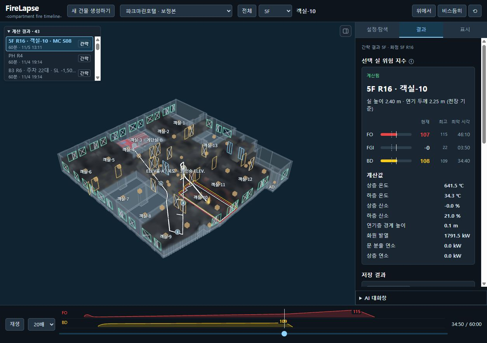
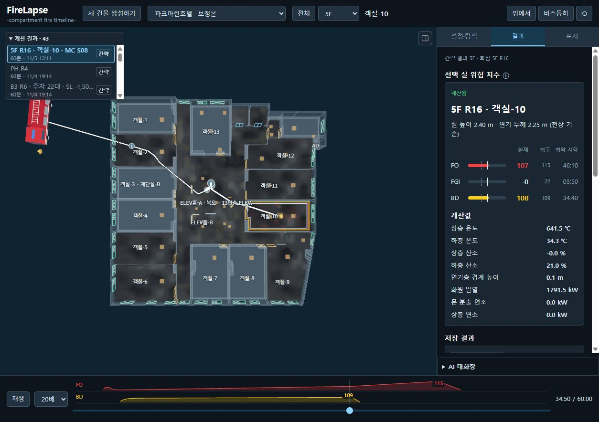
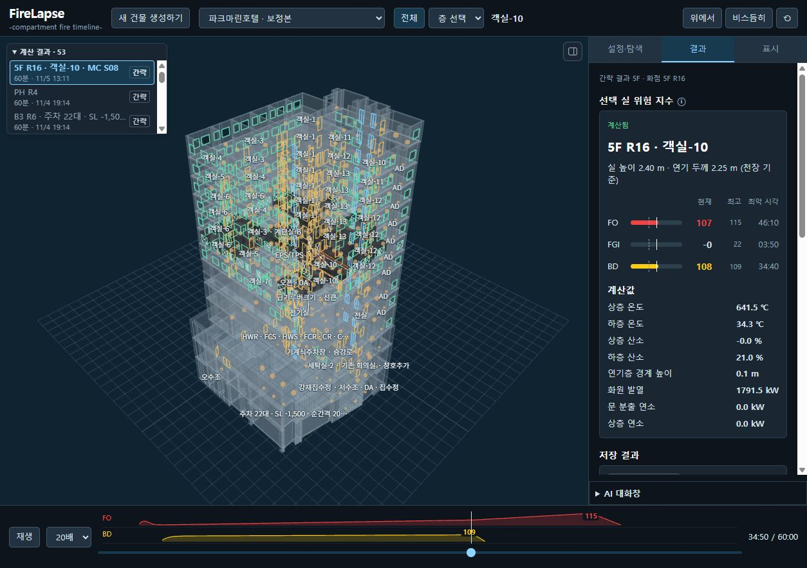
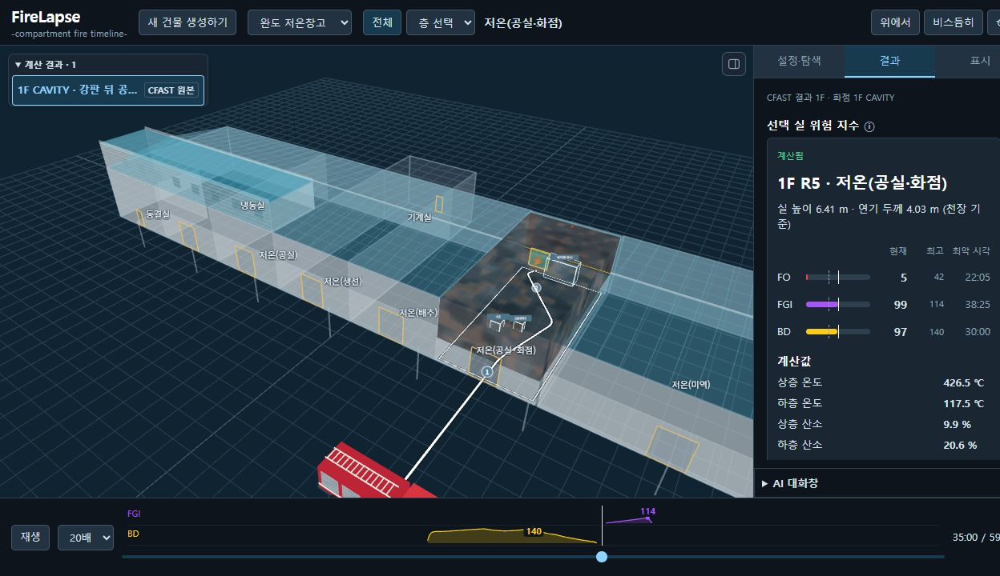

# FireLapse
### -compartment fire timeline-

**3D 건물 모델에서 구획 화재의 진행과 위험 조건을 시간에 따라 살펴보는 Windows용 로컬 앱입니다.**

첫 공개 배포에는 7개 건물 모델과 저장된 계산 결과를 제공합니다. 결과를 바로 재생하거나, 계산 가능한 CAD 건물에서 층·화점·가연물·급기 조건을 설정해 다시 계산할 수 있습니다.

**계산 대상 시간: 30분 또는 최대 60분(1시간) · 기본값: 60분**

이는 시뮬레이션 속 화재 진행 시간입니다. PC에서 실제 계산을 완료하는 데 걸리는 시간은 건물과 엔진에 따라 달라집니다.

[배포 파일 확인](https://github.com/secret5028/firelapse/releases) · [소스 코드](https://github.com/secret5028/firelapse)

## 화면 미리보기

실행 중인 앱에서 직접 캡처한 화면입니다. 호텔은 간략 엔진 저장 결과, 완도는 전용 CFAST P1 결과입니다.

### 호텔 · 층별 결과와 위험 지수



### 호텔 · 위에서 본 평면과 수관 경로



### 호텔 · 전체 건물



### 완도 · 순정 CFAST 35분, R5 선택



## 주요 기능

- **건물 탐색:** 건물·층 선택, 실 이름, 계단·승강기, 문·창과 개폐 상태 표시
- **가연물 설정:** 층 전체 양 조절, 실별 연료 기준·양 설정, 개별 설정 유지
- **화점 선별:** 연료량·환기 부족·화재 확산 연결을 고려한 후보 상위 5개 확인
- **MC 급기 탐색:** 여러 개구부 상태 조합을 계산하고 선택 기준에 따른 최악 표본 적용
- **두 계산 경로:** 간략 엔진 또는 순정 CFAST 선택
- **시간별 재생:** 연기·화염, 온도·산소, FO·FGI·BD 지수와 최고 시각 확인
- **진입 경로:** 소방차 위치와 선택 실을 잇는 수관 경로 표시
- **결과 공유:** 현재 사례를 단독 재생 HTML로 내보내기
- **선택적 AI 연결:** 사용자 API를 연결한 대화·가연물 제안·도면 검토

## 내려받아 실행하기

1. [Releases](https://github.com/secret5028/firelapse/releases)에서 Windows x64용 **FireLapse 실행 패키지 ZIP**을 내려받습니다.
2. ZIP 전체를 쓰기 가능한 폴더에 압축 해제합니다. 예: `D:\FireLapse`. 압축 파일 안에서 바로 실행하지 마세요.
3. `FireLapse.cmd`를 더블클릭합니다.
4. 준비가 끝나면 브라우저에 모델이 열립니다. 상단 목록에서 건물을 선택합니다.
5. 사용하는 동안 실행 창을 유지합니다. 종료할 때는 계산이 끝난 뒤 실행 창에서 **Ctrl+C**를 누릅니다.

실행 패키지에는 Python·Node·필수 라이브러리와 계산 실행 파일이 포함됩니다. 저장된 모델과 결과를 보는 데 별도 API 키나 AI 계정은 필요하지 않습니다.

**GitHub의 `Code → Download ZIP`은 소스 코드입니다.** 모델 결과와 실행 환경을 함께 받으려면 Releases의 실행 패키지를 사용하세요. 배포 파일이 아직 표시되지 않으면 업로드가 완료되지 않은 상태입니다.

### 실행 환경

| 항목 | 내용 |
|---|---|
| 운영체제 | Windows 10/11, x64 |
| 화면 | WebGL 지원 Edge 또는 Chrome |
| 실행 방식 | 압축 해제 후 실행하는 로컬 앱 |
| 접속 | 이 PC의 `127.0.0.1`; 인터넷 공개 서버가 아님 |
| 사용 포트 | 8780, 8832, 8841~8844 |
| 점검 | `Check-FireLapse.cmd`로 모델 파일·의존성 확인 |
| 용량 | 최종 ZIP과 압축 해제 크기는 Release 안내 참조 |

브라우저가 자동으로 열리지 않으면 실행 창의 주소를 사용하세요. 기본 호텔 화면은 `http://127.0.0.1:8842/model.html`입니다. 앱이 실행 중인 PC에서만 접속할 수 있습니다.

## 포함 건물

| 건물 | 제공 범위 |
|---|---|
| 강화 공장 | CAD 기반 3D, 저장 결과, 입력 검사를 통과한 층의 계산 |
| 파크마린호텔 | CAD 기반 층별 3D, 저장 결과, 층별 계산 |
| 완도 저온창고 | 재구성 모델, 전용 CFAST P1 재생, P1·P2·P4·P5 최종 요약 자료 |
| 견본주택 | CAD 기반 3D, 저장 결과, 입력 검사를 통과한 층의 계산 |
| 강화 공동주택 101동 | 스캔 기반 3D 열람 전용 |
| 모도리 267 | 스캔 기반 3D 열람 전용 |
| 아이엔테크놀로지 | CAD 기반 1F·2F 모델, 저장 결과, 층별 계산 |

스캔 기반 건물은 개구부 정보가 검증되지 않아 시뮬레이션을 지원하지 않습니다. 추정한 연결·층고는 모델의 검토 표시와 함께 확인하세요. 완도는 일반 CAD 계산과 구분된 전용 입력·재생 경로를 사용하며, 전용 화면의 HTML 내보내기는 비활성입니다.

## 저장 결과 보기

1. 상단에서 건물을 선택합니다.
2. **3D 화면 왼쪽 위 결과 목록**에서 사례를 누릅니다. `간략`과 `CFAST 원본` 표기로 계산 방식을 구분합니다.
3. 해당 결과의 층·화점실이 선택되고 결과 탭이 열립니다. 현재 보는 결과만 강조됩니다.
4. 아래 시간 막대를 움직이거나 재생 버튼을 누릅니다.
5. 실을 클릭하면 해당 실의 값이 표시됩니다. 자료가 없는 실은 **`—`**로 나타납니다.
6. 내보내기를 지원하는 사례에서는 결과 탭의 **HTML 내보내기**로 단독 재생 파일을 저장합니다. 이 파일은 보기용이며 새 계산은 실행하지 않습니다.

저장 결과가 있는 층과 현재 둘러보는 층은 다를 수 있습니다. 값을 확인하려면 결과 목록에서 원하는 사례를 먼저 선택하세요. 일부 CFAST 대조 자료는 최종 요약 JSON으로 제공되며 재생 목록에 모두 나타나는 것은 아닙니다.

## 새 계산하기

`설정·탐색`에서 화면의 단계 순서대로 진행합니다.

1. **층 선택:** 계산할 층 하나를 선택합니다.
2. **가연물 설정:** 층 전체 양을 조절합니다. 실을 클릭하면 개별 연료 기준과 양을 바꿀 수 있습니다. 개별 설정한 실은 층 전체 변경을 따라가지 않습니다.
3. **화점 확인:** 후보 상위 5개와 점수를 확인하고 화점실을 선택합니다.
4. **MC 급기 탐색:** 계산 시간과 표본 수를 설정하고 개구부 상태 조합을 탐색합니다.
5. **급기 상태 적용:** 선택된 최악 표본과 모델의 문·창 개폐 상태를 확인합니다.
6. **엔진 선택·계산:** 간략 엔진 또는 순정 CFAST를 선택하고 **계산하기**를 누릅니다. 진행 상태를 확인한 뒤 완료된 결과를 엽니다.

| 구분 | 의미 |
|---|---|
| 화점 후보 점수 | 상세 계산 전에 위험해 보이는 실을 선별하는 지표 |
| MC | 여러 급기·개구부 조합을 표본으로 탐색하는 방법 |
| 간략 엔진 | 프로젝트의 간략 물리 모델로 시간별 상태를 계산 |
| 순정 CFAST | CFAST 입력으로 변환해 기준 실행 파일로 계산 |

MC 자체가 별도의 물리 엔진은 아닙니다. 최악 표본은 **실제로 탐색한 조합과 선택 기준 안에서의 결과**입니다. 간략 엔진과 CFAST는 서로 다른 모델이므로 값이 같다고 가정하지 않습니다.

## 지수와 표시 읽기

| 표시 | 의미 |
|---|---|
| FO | 플래시오버 관련 조건 충족 지수 |
| FGI | 가연성 화재 가스의 점화 관련 조건 충족 지수 |
| BD | 고온 연기 축적·산소 부족 등 백드래프트 관련 조건 충족 지수 |
| 100 | 앱에서 정의한 조건 기준에 도달 |
| 롤오버 조건 충족 | FGI에 연결된 부속 상태; 독립된 네 번째 지수가 아님 |
| 연기 두께 | 천장에서 상층·하층 경계까지의 두께 |
| `—` | 계산 자료가 없거나 해당 항목이 미평가됨 |

지수는 발생 확률이 아닙니다. 100에 도달했다고 실제 현상이 발생했다고 확정하지 않으며, **계산된 0과 미평가 `—`를 구분**합니다.

3D에서는 FO 빨강, FGI 보라, BD 노랑을 사용합니다. 수관은 흰색, 계단·승강기는 청색 계열, 실내 문은 금색, 외부 창은 청록색입니다.

## 새 CAD와 AI

**포함된 7개 건물은 추가 CAD 도구 없이 열 수 있습니다.** 새 DWG·DXF로 모델을 만들려면 별도 CAD 추출 도구·변환기와 `config/cad-import.local.json` 설정이 필요합니다. 예시는 `config/cad-import.example.json`에 있습니다.

- 새 건물 생성에서 CAD 파일을 추가하고 건물 이름·층 구성·검토 항목을 확인합니다.
- 누락 층이나 심각한 결측이 있으면 생성·계산이 제한됩니다.
- 확실한 기하 보정은 자동 적용하고 애매한 공간·연결은 추정 또는 미확인으로 남깁니다.
- AI 기능을 사용하려면 `설정·탐색 → AI 연결`에서 API 주소·모델·키를 입력합니다.
- 이미지 판독에는 실제로 이미지를 처리하는 모델과 호환 API가 필요합니다. 단순 연결 성공만으로 도면 판독 성공을 보장하지 않습니다.
- 연결 키는 서버 메모리에 보관되므로 앱을 재시작하면 다시 연결해야 합니다. 제작자의 API 키는 배포하지 않습니다.

새 CAD를 API AI로 자동 보정하고 검증하는 전체 과정은 **통합 검증 미완료**입니다. 어떤 CAD든 동일한 품질로 모델·계산 입력이 생성된다고 보증하지 않습니다. AI 미연결 상태의 용도별 기준 배치를 실제 AI 검토 완료로 해석하지 마세요.

## 저장 위치와 용량 관리

```text
FireLapse/
  FireLapse.cmd               앱 실행
  Check-FireLapse.cmd         구성 점검
  README.md                  사용 설명서
  THIRD_PARTY_NOTICES.md      구성요소·라이선스 안내
  distribution.json          배포 정보
  files.sha256.json           파일 무결성 목록
  runtime/                   Python·Node 실행 환경
  app/config/                건물 목록·앱 설정
  app/data/                  건물 모델
  app/cad-project/           강화 모델·공통 3D 리소스
  app/simulation/config/     계산 설정
  app/simulation/results/    저장 결과·새 계산 결과
  logs/                      실행 후 생성되는 서버 로그
```

첫 배포에는 최종 재생 결과와 재계산에 필요한 모델·설정·엔진을 포함합니다. 대용량 중간 행렬·원본 CSV·개발 로그·시험 캡처는 제외합니다. 결과 수치는 패키징을 위해 다시 계산하거나 변경하지 않습니다.

**앱과 계산 자료는 같은 압축 해제 폴더 아래에 있습니다.** 별도 데이터 드라이브로 자동 분리하거나 오래된 결과를 자동 삭제하는 기능은 없습니다. 새 계산을 반복하면 결과와 계산 과정 파일이 추가되므로 여유 공간을 확인하세요. 백업은 계산과 앱을 종료한 뒤 폴더 전체를 복사하는 방식이 안전합니다.

## 문제 해결

| 증상 | 확인 방법 |
|---|---|
| 실행되지 않음 | ZIP을 모두 해제했는지 확인하고 `Check-FireLapse.cmd`와 `logs/` 확인 |
| 포트 사용 중 | 먼저 실행한 FireLapse 창 종료; 다른 프로그램을 임의 종료하지 않음 |
| 모델이 안 보임 | WebGL 지원 브라우저와 그래픽 가속 확인 |
| 선택 실의 결과가 `—` | 결과 목록의 층·화점과 현재 선택 실 확인 |
| 스캔 건물에서 계산 불가 | 열람 전용 모델이므로 정상 동작 |
| 새 CAD 생성 불가 | CAD 도구 설정과 누락 층·결측 검토 |
| AI 연결·판독 실패 | API 주소·인증·이미지 지원·응답 시간 확인 |
| 완도에서 일반 계산 상태 오류 | 전용 재생 경로의 일반 계산 상태 API 미지원 사항 확인 |

## 첫 배포의 지원 범위

- 일반 CAD 계산은 층별 구획 입력을 사용합니다. 전 층의 연기 전파를 함께 검증한 것으로 해석하지 않습니다.
- 모델의 불확실한 연결과 일부 물리 근사는 남아 있습니다. 엔진·입력·추정 표시를 함께 확인해야 합니다.
- 완도 전용 보기 서버의 일반 계산 상태 API(`/cfbt/calculation`)는 미지원이며 404가 발생할 수 있습니다.
- 이번 실행 패키지 검증에서 새 시뮬레이션을 실행한 것은 아닙니다. 입력 준비·저장 결과 재생과 새로운 계산의 물리 정확도 검증은 구분합니다.
- 이 앱은 시나리오 계산·시각화 도구입니다. 현장 측정이나 실제 화재 발생 예측을 대신하지 않습니다.

## 소스와 개발

소스 저장소: [secret5028/firelapse](https://github.com/secret5028/firelapse)

저장소의 앱 소스는 `PyroCast/`에 있습니다. 실행 패키지에서는 `app/`에 배치됩니다. 내부 폴더명·`pyrocast_*` 식별자는 저장 결과 호환용이며 제품명은 **FireLapse**입니다.

- UI 소스: `app/web/`
- 모델 등록·API·배포 도구: `tools/`
- 엔진·설정·뷰어: `simulation/`
- UI 번들 생성: 앱 소스 루트에서 `python tools/build_ui_bundle.py`
- 배포 구성: `tools/build_distribution.py`
- 실행 진입점: `tools/launch_firelapse.py`

소스 ZIP만으로 실행 패키지의 모든 결과와 런타임이 제공되지는 않습니다. 구성요소 라이선스는 배포본의 `THIRD_PARTY_NOTICES.md`와 각 원문 고지를 따릅니다.
