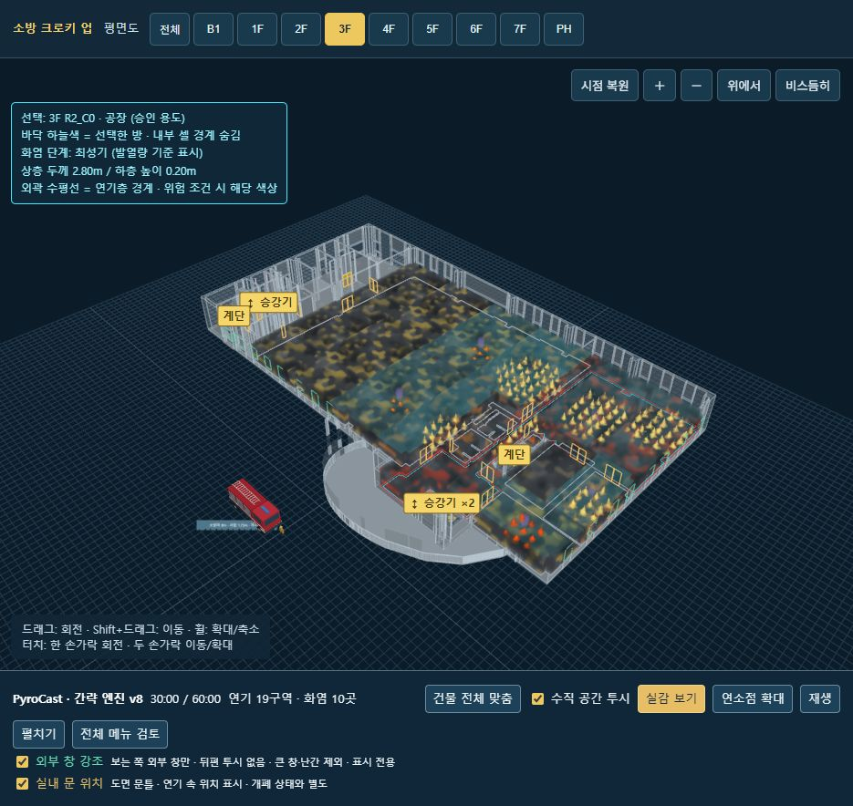

# FireLapse
-compartment fire timeline-

2026-11-05 현재 앱. 새 CAD 생성·AI 공리 보정 연결, 모델 선택, 층별 가연물/화점, MC 급기 탐색, 간략/CFAST 실행, 저장 결과 재생 UI를 포함합니다.

- **검토·수정 시작:** [Claude 인계서](specs/Claude-review-handoff-20261105.md)
- **업로드 전 점검:** [시험·수관 수정·미해결 수치 오류](reviews/prepublish-review-20261105/report.md)
- 실행: 이 폴더에서 `python tools/serve_model_library.py --port 8841`, 이후 `http://127.0.0.1:8841/models/`.
- CAD 변환기·CFAST 실행 파일·AI 키는 별도 로컬 준비가 필요합니다. 실제 키와 전체 계산 결과/의존 패키지는 포함하지 않습니다.
- 전체 물리 검증 완료 제품이 아닙니다. MC 수치 실패 수정·10표본 완주 및 새 건물 HTML 내보내기 검증은 [수정 보고](reviews/mc-export-fix-20261105/numerical-report.md)에 기록했습니다. 추가 미검증 항목은 인계서를 참고하세요.

---
아래는 보존된 2026-10-26 체크포인트 안내입니다.

# PyroCast · 2026-10-26 체크포인트

현재 작업 중인 간략 엔진, 보존된 CFAST 확장/정밀 코드, 3D 표시 코드와 명세입니다.
저장소 루트의 10월 19일 CAD 체크포인트는 그대로 보존했습니다.

## 현재 화면 실행

Python 3.12 환경에서 이 폴더를 작업 디렉터리로 사용합니다.

```sh
python -m pip install -r requirements-viewer.txt
python start_viewer.py
```

터미널에 출력되는 `http://127.0.0.1:8780/cad-result/.../model.html` 주소를 엽니다.
기존 서버와 포트가 겹치면 `python start_viewer.py --port 8781`을 사용합니다.
저장된 결과의 압축을 처음 한 번 풀어 재생하며, 시작만으로 시뮬레이션을 재실행하지 않습니다.
정밀 계산용 실행파일과 컴파일 도구는 포함하지 않았으므로 새 CFAST 계산에는 별도 준비가 필요합니다.
과거 전체 계산 결과·PC의 설치 패키지를 모두 백업한 것은 아닙니다.

## 포함된 현재 상태

- 간략 엔진 v8, 문 분출 연소 ON. R2 화점의 1시간 MC 10개 완료 결과와 기준 사례.
- 기본 재생 사례 S06, 3F 한 층 결과. 이 결과를 전층 수직 전파로 해석하지 않습니다.
- 실내 문은 금색 문틀선으로 연기 속에서도 표시. 위치 표시이며 개폐 상태를 뜻하지 않습니다.
- FO 등 위험 테두리는 원래 방 외곽 전체에 표시. 일부 셀에서 조건을 충족해도 표시됩니다.
- 선택은 바닥 하늘색 테두리, 내부 셀 분할선 숨김, 층 변경 시 시점 유지.
- 외부 창은 보는 쪽 사각형만 강조. 계단·승강기 전체 건물 투시 유지.
- 실감 화염·연기, 작은 무늬로 분산된 온도색. 선 형태 실험은 되돌렸습니다.
- 상승 플룸·천장 고온 가스는 간략 결과에 CFAST 계열 상관식을 적용한 보조 표시입니다.
- 재생 속도 1·5·10·20·30·60배. 전체 메뉴 검토창은 이전 메뉴까지 읽기 전용으로 펼칩니다.

온도색·연기 무늬·불꽃 크기는 표시 효과입니다. 온도색 움직임은 실제 실내 유동장이 아니며,
플룸 표시도 순정 CFAST 출력 또는 CFD 검증 결과와 동일하지 않습니다.
현상 지수는 설정 조건의 충족 정도이며 발생 확률이나 정확한 발생 시각의 예측이 아닙니다.

## 파일과 검증

- `simulation/pyrocast_lite`, `simulation/pyrocast_cfbt`: 간략/정밀 및 추가 모델.
- `simulation/vendor/cfast-7.7.7`: 출처가 기록된 원본 소스.
- `simulation/viewer`, `tools/serve_cfbt_building.py`: 현재 화면과 서버.
- `cad-project`: 현재 추출 건물·HTML·Three.js 자산.
- `saved_results`: 무손실 gzip 저장 결과. 실행 시 `simulation/results`로 복원됩니다.
- `specs`, `SESSION_HANDOFF.txt`: 확정 사항과 작업 기록. 과거 지시보다 최신 사용자 결정이 우선합니다.
- `SNAPSHOT-MANIFEST.json`: 복사 원본 해시. 설정의 PC 절대경로만 상대경로로 정리했습니다.

최근 표시 변경은 JavaScript 문법, 실제 브라우저 화면과 콘솔 오류를 확인했습니다.
이번 업로드를 위해 화재 계산을 다시 실행하지 않았습니다.


