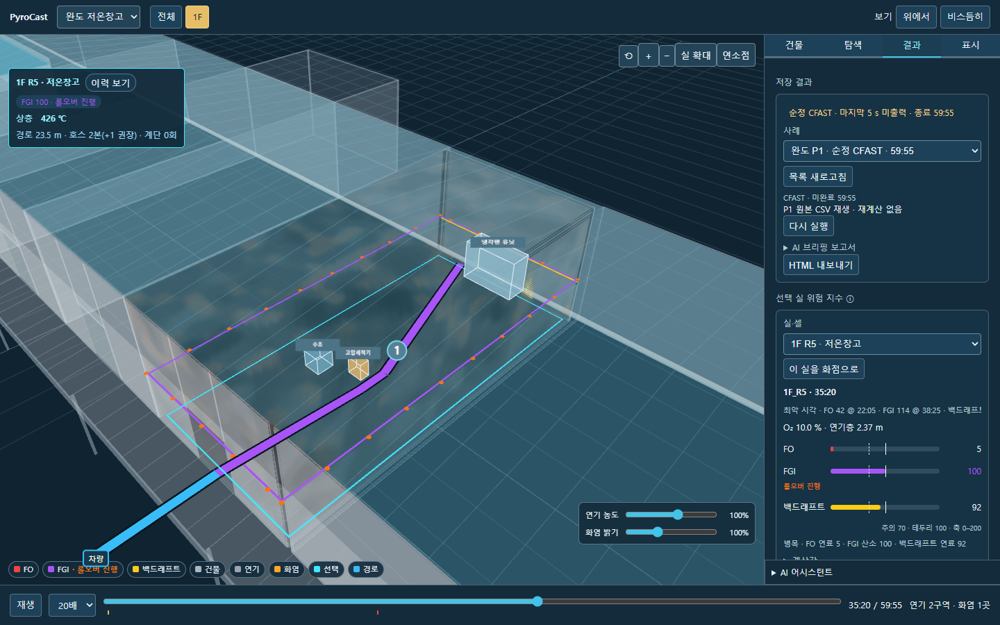
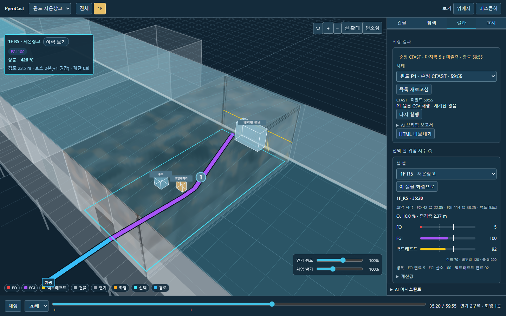
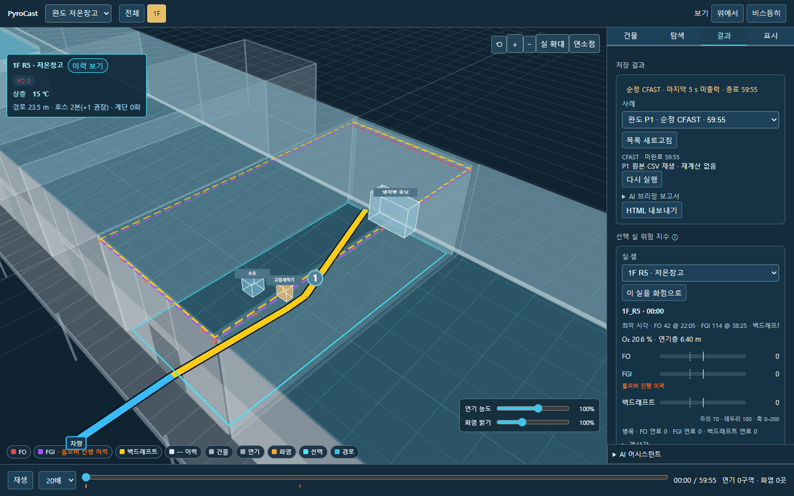
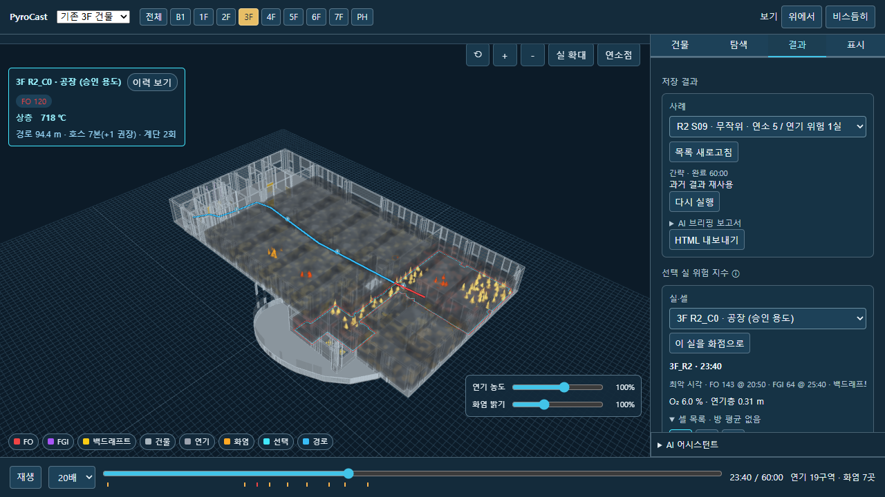

# 롤오버 → FGI 부속 상태 적용

요청 범위 1커밋. 시뮬레이션 재실행 0회. 기존 농도 슬라이더는 유지.

## 판정·표시

- 현재 열린 개구부로 직접 연결된 연소실의 실제 HRR >0 또는 수신 door jet >0을 점화원으로 사용. 연결망은 실제 가스 유속 방향의 해석값이 아니다.
- 최초 화점실과 모든 소속 셀 제외. 외기 최단 경로 조건 제거.
- `FGI.rollover`에는 점화원 여부·최초 시각·진행 상태만 저장. 별도 지수 없음. 테두리 임계값 변경 시 저장 FGI·점화원 시계열로 재판정.
- 막대·리본·이력 최고·MC·브리핑은 FO/FGI/백드래프트 3종. FGI 배지 + 보라 리본 위 주황 점.
- 이력은 점화원이 있던 시점의 FGI를 사용. 서로 다른 시점의 최고 FGI와 점화원을 조합하지 않음. R-1은 같은 시점 FGI≥100 AND 롤오버 진행.

## 재산출

- 3F 24개 저장 사례 + 완도 6개(P1/P2/P4/P5 400·450·500), 684개 원래 방 비교 행.
- FGI 최고 전후 차이 0. 백업 31개 playback/timeseries에서 롤오버 항 외 물리 시계열·화원·나머지 조건지수 동일.
- 전체 실별 표: [room-comparison.csv](room-comparison.csv). 최초 진행은 기본 테두리100 기준.

| 완도 사례 | 실 | FGI 최고 전 | 후 | 최고 시각 | 기존 롤오버100 최초 | 새 진행 최초 |
|---|---|---:|---:|---|---|---|
| P1 | CAVITY | 19.89 | 19.89 | 43:50 | 미도달 | 미도달 |
| P1 | R5 | 114.1 | 114.1 | 38:25 | 35:20 | 35:20 |
| P2 | CAVITY | 19.65 | 19.65 | 43:55 | 미도달 | 미도달 |
| P2 | R5 | 114.14 | 114.14 | 38:25 | 35:10 | 35:10 |
| P4 | CAVITY | 16.57 | 16.57 | 48:30 | 미도달 | 미도달 |
| P4 | R5 | 40 | 40 | 11:00 | 미도달 | 미도달 |
| P5/400 | CAVITY | 59.8 | 59.8 | 51:45 | 미도달 | 미도달 |
| P5/400 | R5 | 134.88 | 134.88 | 30:35 | 28:00 | 28:00 |
| P5/450 | CAVITY | 19.89 | 19.89 | 43:50 | 미도달 | 미도달 |
| P5/450 | R5 | 114.1 | 114.1 | 38:25 | 35:20 | 35:20 |
| P5/500 | CAVITY | 19.89 | 19.89 | 43:50 | 미도달 | 미도달 |
| P5/500 | R5 | 114.1 | 114.1 | 38:25 | 35:20 | 35:20 |

완도 P1 R5: 2,120 s(35:20)에 진행, FGI 최고114.0966 @2,305 s. CAVITY는 화점실 제외.

### 3F 사례별 진행 실 수

| 사례 | 기존 롤오버100 실 | 새 진행 실 |
|---|---:|---:|
| lite_mc_jobs/mc-1793171631584057100-c3f54953/S00 | 0 | 0 |
| lite_mc_jobs/mc-1793171631584057100-c3f54953/S01 | 0 | 0 |
| lite_mc_jobs/mc-1793585166727903100-b0a36258/S00 | 0 | 0 |
| lite_mc_jobs/mc-1793585166727903100-b0a36258/S01 | 0 | 0 |
| lite_mc_jobs/mc-1793596576284695400-55af780d/S00 | 0 | 0 |
| lite_mc_jobs/mc-1793596576284695400-55af780d/S01 | 0 | 0 |
| lite_screening_ui_1793581362271399500/CAD_3F_R11/closed | 0 | 0 |
| lite_screening_ui_1793581362271399500/CAD_3F_R11/open_except_confirmed | 0 | 0 |
| lite_screening_ui_1793596486525636600/CAD_3F_R3/closed | 0 | 0 |
| lite_screening_ui_1793596486525636600/CAD_3F_R3/open_except_confirmed | 0 | 0 |
| lite_screening_ui_1793597384213006900/CAD_3F_R3/fixed | 0 | 0 |
| lite_v8_mc_R2_10_20261026/S00 | 0 | 0 |
| lite_v8_mc_R2_10_20261026/S01 | 0 | 0 |
| lite_v8_mc_R2_10_20261026/S02 | 0 | 0 |
| lite_v8_mc_R2_10_20261026/S03 | 0 | 0 |
| lite_v8_mc_R2_10_20261026/S04 | 0 | 0 |
| lite_v8_mc_R2_10_20261026/S05 | 0 | 0 |
| lite_v8_mc_R2_10_20261026/S06 | 0 | 0 |
| lite_v8_mc_R2_10_20261026/S07 | 0 | 0 |
| lite_v8_mc_R2_10_20261026/S08 | 0 | 0 |
| lite_v8_mc_R2_10_20261026/S09 | 0 | 0 |
| lite_v8_stage4_R2_20261026 | 0 | 0 |
| ui_C9_20261102/radial | 0 | 0 |
| ui_C9a_20261102/radial_area | 2 | 1 |

### 미처리 자료

- 옛 순정 3F 아카이브31건: 수치 FGI·실제 HRR 등 필수 원값 부족. 원파일 유지, 새 롤오버 상태는 미평가(null). 독립 롤오버 지수는 화면에 노출하지 않음.
- 완도 P3: 저장 결과 없음. 재실행 금지에 따라 새 계산하지 않음.
- 개별 목록/사유: [comparison.json](comparison.json)의 unavailable. 과거 PNG·보고서·이미 내보낸 HTML은 당시 산출물로 보존.

## 검증

- 판정 단위시험5건: 열린/닫힌 연결·임계값·외기 경로 불필요·수신 분출 단독 점화원·화점 전체 셀 제외·미평가 보존.
- 실제 S09/완도 읽기 도구5건, 모의 LLM·브리핑10건 통과. R-1 조건과 근거 도구 연결 검증. 실제 AI API 호출 없음.
- S06/S09/stage4 계약3건: 각각 원값137,180개·조건값274,360개 그대로. 3현상+FGI 부속 상태 스키마 검증 통과.
- 위험 레이어 현재/이력 검증 통과. 임계값 변경 시 기하 재생성 없음·dispose 자원0.
- 완도2120 s: 지수바3개·주황 점 리본1개·배지. 임계값120이면 점/배지 없음. 이력ON 0 s는 이력 점/배지, OFF 0 s는 없음. 콘솔오류0·구독누수0.
- 3F S09 1420 s: R2_C0/C1/C2 제외true·지수바3개. 단독 HTML 7,329,510 bytes, HTTP요청0·콘솔오류0.
- 완도 보기 서버의 기존 내보내기 경로는 미지원이므로 완도 HTML 내보내기 검증은 제외. 3F 기존 내보내기로 새 스키마 오프라인 동작 검증.
- 엔진 core·입력 어댑터·실감 셰이더/bridge/real 레이어·서버 코드 내용 불변. 작업본과 Git 미러의 기존 줄바꿈 차이를 정규화한 SHA 일치; 양쪽 원본 SHA도 [protected-files.json](protected-files.json)에 기록.
- 로컬 서버를 새 읽기 API 반영을 위해 재시작. 계산 작업0.

## 캡처

## 명세 v9 §4.1 문구

롤오버는 독립 지수가 아닌 FGI 부속 상태로, 최초 화점실을 제외하고 현재 열린 개구부로 연결된 연소실 또는 수신 door jet의 점화원이 있으며 FGI가 테두리 임계값 이상일 때 진행으로 표시한다.

완료 후 정지. 다음 농도 슬라이더 작업은 하지 않음.
