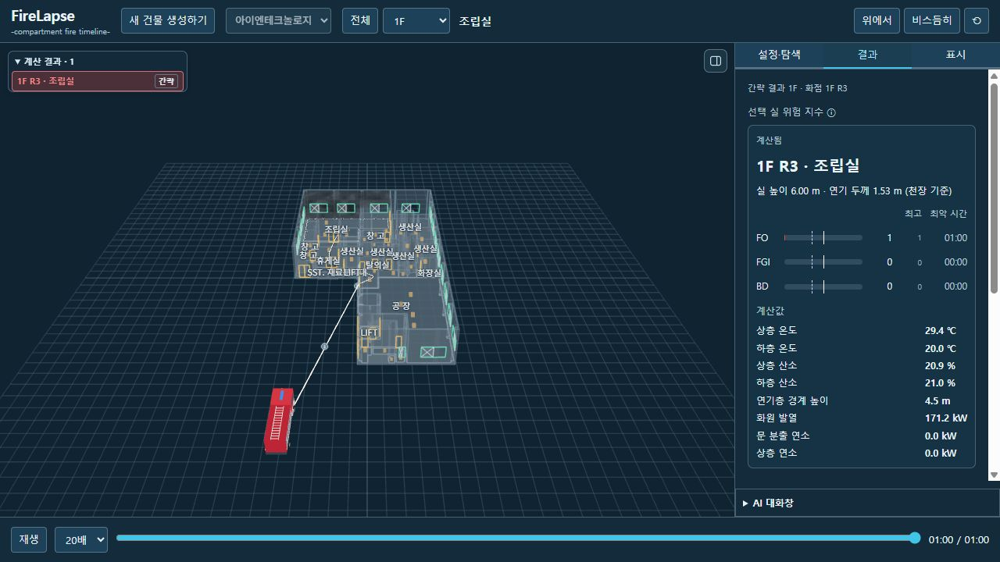

# 새 건물 HTML 내보내기 복구

원인: `operation.js`가 내보내기 버튼을 강제로 비활성화했고, 모델별 서버에는 내보내기 경로가 없었다. 기존 패키저는 강화/완도 방식의 inline module·CAD 자산 경로·legacy-context를 전제로 했다.

수정:

- 새 건물 서버에 저장 결과 전용 GET/POST 내보내기 경로 연결. Loopback·동일 출처 POST·상태 크기 제한·건물별 완료 사례 검사 유지.
- 모델 서비스의 external operation.js와 공유 패널/레이어/Three 모듈 74개를 파일 안으로 묶음. 건물 JSON·playback·실별 가연물 표시 설정·개폐 상태·차량/경로·카메라/시간바 상태 포함.
- 화면 상태가 긴 경우 GET URL 제한(HTTP 414)이 재현되어 모델 서비스는 POST 사용. 기존 강화/완도 GET 경로는 유지.
- 파일명 FireLapse 사용. 사례를 바꿨을 때 이전 파일 크기 표시를 지우고, 저장 중 사례가 바뀌어도 요청한 사례 ID로 다운로드.
- 단독 파일의 건물 이름이 강화로 잘못 보이던 기본값 제거. 포함된 건물명만 표시하고 건물 변경/새 생성/계산 버튼은 보기 전용.

검증:

| 항목 | 결과 |
| --- | --- |
| 실제 운영 버튼 | 새 건물 1.03 MiB 저장 완료 |
| 아이엔테크놀로지 POST | 200, 1,078,744 bytes |
| 호텔 POST | 200, 2,550,900 bytes |
| 단독 재생 | API 없는 정적 서버에서 결과 표시, 재생 0→60초, 시간바, 흰 수관 확인 |
| 호텔 파일 | PH R4 저장 결과·3600초 시간바·건물명 확인 |
| 외부 의존 | 단독 파일 CSP connect-src none. 정적 서버 로그에 HTML 파일 요청만, 모듈/API 요청 없음 |
| 시험 | 패키저 단위 시험 5건 통과. 수정 Python/JS 구문 검사 통과 |

`file://` 직접 실행은 이번 자동 검증에 포함하지 않았다. API 없는 정적 HTTP와 파일 내부 CSP 차단으로 독립 동작을 확인했다. 실제 HTML 출력물은 로컬 reviews 폴더에 보관하고 전체 계산 결과는 Git에 추가하지 않는다.

