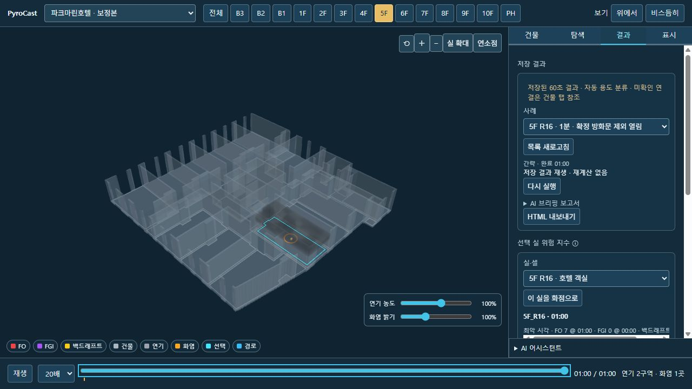
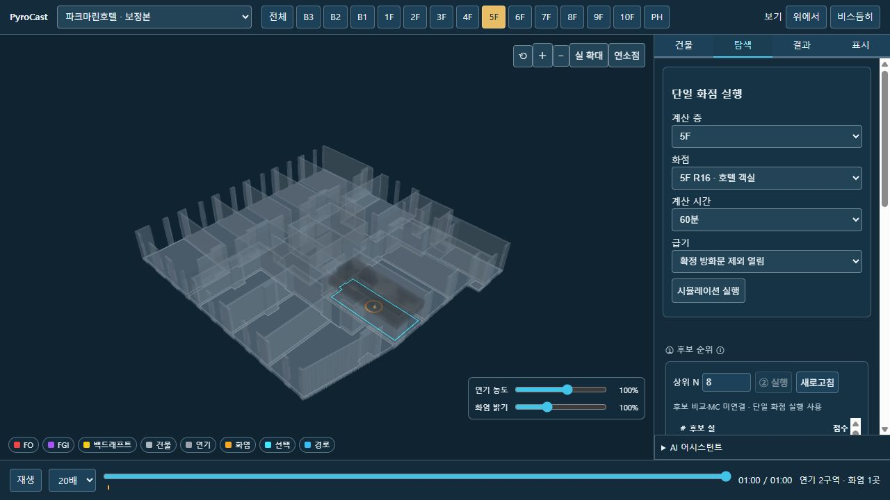
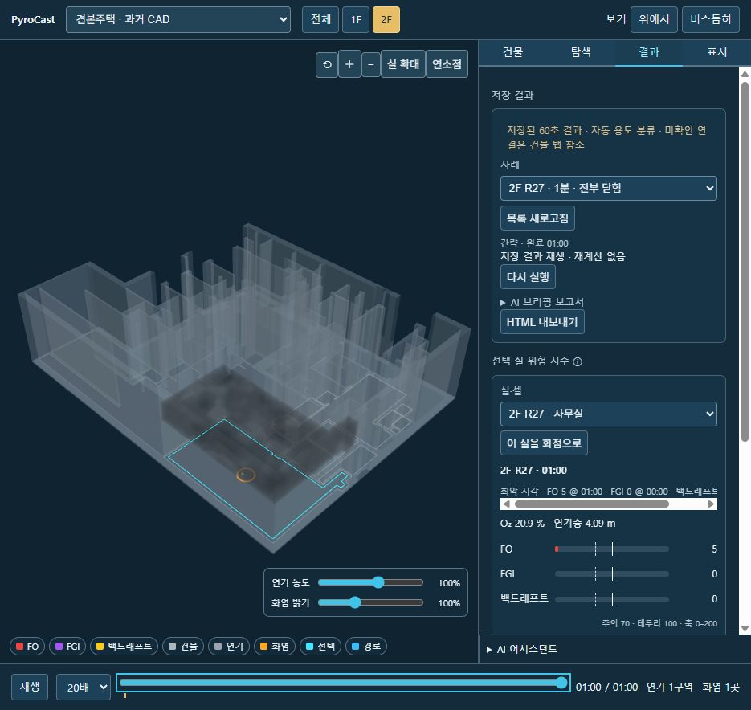
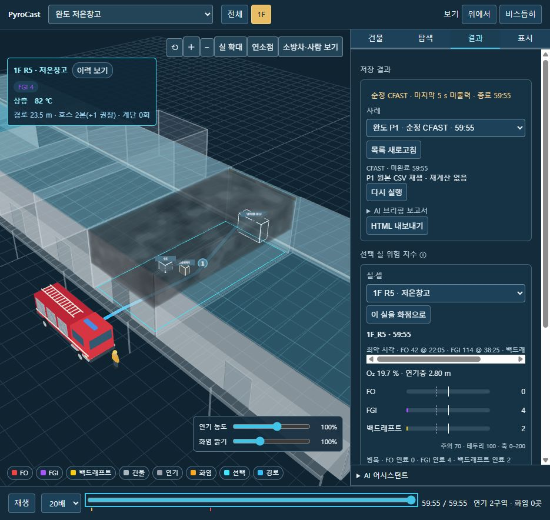

# 모델 운영 UI 통합 — 2026-11-04

## 결과
호텔과 견본주택에 완도/강화와 동일한 app/web 운영 호스트·레이어·패널을 연결했다. 별도 모델 보관함은 모델 선택/형상 검토용이고, `운영 화면 · 시뮬레이션`으로 공통 UI에 진입한다. 공통 상단 건물 선택기에서도 서로 전환된다.

- 호텔: http://127.0.0.1:8842/model.html
- 견본주택: http://127.0.0.1:8843/model.html
- 완도/강화 기존 운영 주소 유지.
- `tools/serve_model_library.py --port 8841` 한 프로세스가 8841 목록과 8842/8843 건물별 API를 함께 제공한다. 기존 직렬 실행 잠금 공유. 모두 127.0.0.1에만 바인딩.

## 연결 범위
- 건물 / 탐색 / 결과 / 표시 4탭, 단일 캔버스, 공통 스토어·위험지수·선택·이력·연기/화염·경로 레이어 재사용.
- 기존 단일 화점 실행 폼은 탐색 탭으로 이동. 층/화점/시간/급기 선택, 완료 시 사용자가 결과 보기. 자동 실행/자동 장면 교체 없음.
- 후보 표는 선택 계산 층의 기존 점수를 읽음. ② 비교 및 ③ MC는 미연결로 명시·비활성. 과거 한 건을 순위표나 MC 결과로 가장하지 않음.
- 호텔/견본주택에서 문 정정·AI·정밀 실행·단독 HTML 서버 경로는 미연결 상태이므로 비활성. 기존 완도/강화 기능은 유지.
- 자동 용도 분류와 도면 미확인 목록 유지. 호텔 B1 계산 불가 유지. 원본·엔진·셰이더·전이식 불변.
- 결과는 건물 해시 일치하는 저장 작업만 제공. 다른 건물 작업 ID 요청 거부. 원본 결과 파일은 수정하지 않고 응답에 case_id만 추가.

## 검증
새 시뮬레이션 **0회**. 이전 저장 작업 2건만 읽음(status SHA/폴더 수 불변).
- 호텔 5F R16 / 60 s 및 견본주택 2F R27 / 60 s 저장 결과를 공통 UI에서 재생.
- 건물 선택기 전환, 4탭, 결과 타임라인, 연기·화염 ON/OFF 왕복, 이력 ON/OFF, 계산 층 5F→6F→5F 후보 갱신 확인.
- 호텔 단일 실행 버튼 활성, ②/MC/내보내기 미연결 버튼 비활성. 실행 버튼은 누르지 않음.
- 호텔 건물 탭 연료표 23실 확인. AI 미연결 응답은 기존 연료표를 비우지 않음.
- 캔버스 1개. 브라우저 JS 오류 0. GET API 16건 통과.
- Python 입력/경로/모델 격리 15개 통과. explore.unit.mjs 통과. JS 문법 검사 통과.
- building_panel.unit.mjs: 12행 `attention_room_count null !== 2` 실패. 변경 전 e2f258d 저장소 코드로도 동일 재현. 기존 오래된 기대값 실패로 구분, 이번 작업에서 수정하지 않음.
- 엔진 Python/실감 셰이더/렌더 순서 파일은 저장소와 텍스트 동일(기존 CRLF 차이 제외). 공통 overlay 번들은 소스로 재생성.

호텔/견본주택의 다른 층도 형상은 볼 수 있지만 시계열은 저장 계산 층만 존재한다. 아직 미계산 층의 온도/위험을 만들어 표시하지 않는다.

