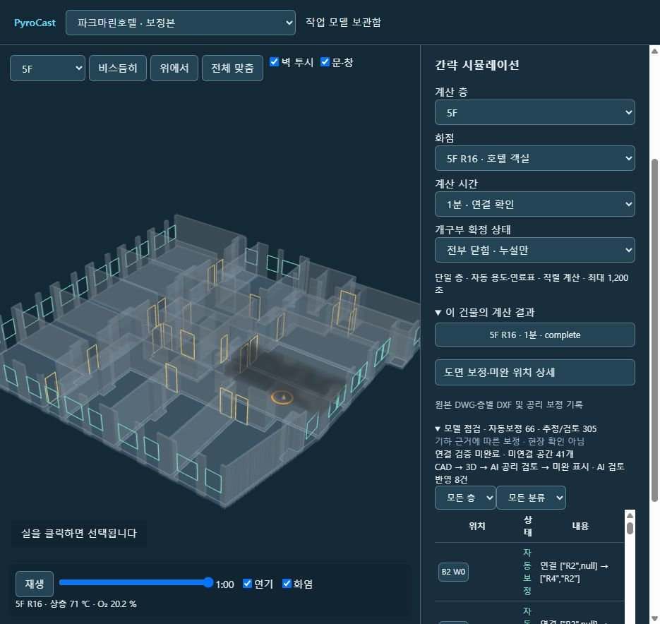
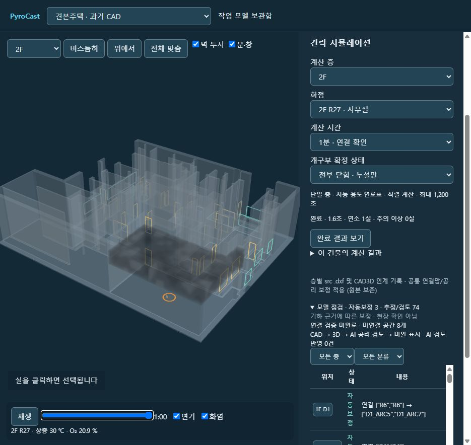

# 건물별 시뮬레이션 연결 — 2026-11-04

- 강화: 기존 운영 계산 경로 유지.
- 호텔: 14층 중 13층 입력 검증 통과. B1은 `Opening wider than usable equivalent room: CAD_B1_R9`로 비활성.
- 견본주택: 원본 보존, 공통 연결망·공리 보정본 생성. 2층 모두 입력 검증 통과. 미연결 8실 등 추정/미확인 표시는 유지.
- 스캔 2건: 버튼 및 서버 모두 계산 차단.
- 완도: 공동·절단·배풍기 전용 CFAST 사례 결과 보기 유지. 일반 CAD 간략 실행 대상으로 변환하지 않음.

## 동작
건물 → 계산 층·화점·시간·급기 선택 → 시뮬레이션 실행 → 완료 결과 보기. 동일 모델에서 연기·화염·타임라인 재생. 결과는 건물별 별도 디렉터리에 저장. 기존 결과 수정 없음.

기존 간략 엔진·전이 규칙·v8 공급 계산·연료표를 재사용한다. 자동 용도 분류이며 사용자 확정값으로 주장하지 않는다. 한 층만 계산(수직/창 파괴 OFF). 1분·30분·60분 지원, 실행 예산 1,200초, 직렬, 실패 시 자동 재실행 없음. 입력 검증 통과는 현장 정확도 검증이 아니다.

## 웹 버튼 실제 시험
| 건물 | 화점/조건 | 모의 시간 | 총 계산 | 적분 | 결과 |
|---|---|---:|---:|---:|---|
| 호텔 5F | R16 / 확정 방화문 제외 열림 | 60 s | 3.409 s | 3.207 s | 완료·연소 1실·주의 0실 |
| 견본주택 2F | R27 / 전부 닫힘 | 60 s | 1.589 s | 1.368 s | 완료·연소 1실·주의 0실 |

두 건 모두 playback/index-summary 생성, 같은 3D에서 재생 확인. 호텔 60초 71℃·O₂20.2%, 견본주택 30℃·20.9%. 모델 전환 후 저장 결과 재열기, 연기/화염 토글 왕복 확인. 브라우저 오류 0. 30/60분 완주 시험은 이번에 실행하지 않았다.

입력/모델 격리·잘못된 층/시간·작업 경로 검사 포함 단위 시험 12 통과. 스캔 POST 400, 다른 운영 경로 건물 POST 400, 외부 Origin POST 403. 엔진/셰이더 수정 없음(기존 루트/저장소 CRLF 차이를 제외한 텍스트 비교). 입력의 미확인 연결·용도를 성공 계산으로 숨기지 않음.

