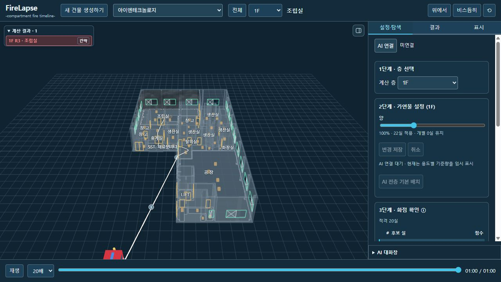

# FireLapse 업로드 전 내부 점검 — 2026-11-05

판정: 화면/경로 수정 검증 완료. 전체 계산 무오류 판정은 아님. 아래 수치 적분 실패는 미해결로 남긴다.

## 수정

- `06207d2`: 새 아이엔테크놀로지 건물 수관 복원. D0 양개문의 경첩이 A,B,B,A 순서라 첫/마지막 좌표로 방향을 만들면 0 길이→NaN이 됐다. 가장 멀리 떨어진 실제 경첩 쌍으로 방향을 구한다. 원본 건물·연결 간선·물리 입력은 변경하지 않았다.
- 확인: 기본 차량은 건물 외곽과 차량 크기를 고려해 10m 이상 이격. 1F R3 경로 56.3439566m, 43구간, 호스 4본, 계단 0회. 호텔 경로 시험도 통과.
- `407eea5`: 경로 요약에서 반올림하면 0이 되는 작은 지수는 `—`. 툴팁은 실제 값과 미평가를 구분한다. 결과 카드의 유효한 계산 0은 유지.
- 독립 롤오버 지수를 기대하던 오래된 경로 시험을 현재 FO/FGI/BD 3지수 정책에 맞췄다. 생산 위험 계산식 변경 없음.
- 강화 8780 서버가 실행 중이 아니어 연결 거부. 기존 저장 결과 재생 서버를 다시 실행해 `/model.html`→현재 CAD 주소→HTTP 200을 확인했다. 기존 모델 서버/MC 프로세스는 재시작하지 않았다.

## 검증

| 구분 | 결과 |
| --- | --- |
| Python 관련 단위 시험 | 70건 통과. CAD 파이프라인·보정·등록·운영·계산 요청·MC·급기 확정·가연물·AI 연결 |
| JS 관련 시험 | 9개 시험 파일 통과. 경로/차량·결과 선택·계산 상태·미평가 구분 포함 |
| Python 구문 | 153파일 AST 파싱 오류 0 |
| 운영 주소 | 강화·호텔·완도·견본주택·아이엔테크놀로지 5개 HTTP 200 |
| 실제 UI | 새 건물 수관/차량 표시, 저장 결과 클릭→1F R3·결과 탭, 새로고침 뒤 60초 결과 유지 확인 |
| 키 점검 | 추적 파일에 실제 ai.json/로컬 CAD 설정/키 파일 없음. 업로드 변경분의 대표 키 패턴 탐지 0. 완전한 비밀정보 보증은 아님 |

전체 브라우저/물리 회귀를 모두 실행한 것은 아니다. 시험 목록과 원출력은 동봉 JSON을 참조한다.

## 수치 오류: 확인된 범위

아이엔테크놀로지 1F R3 30분 MC의 앞선 필수 2표본은 BDF/Radau 모두 `Factor is exactly singular`로 실패했다. 60초 계산은 성공했다. 앞선 S00 BDF의 마지막 저장 상태 520초에서 상태·우변·1회 Jacobian은 유한하고, Jacobian 0열은 없었다. 마지막 저장 시각은 실제 실패 시각을 뜻하지 않는다.

SciPy 차분 보정 계수가 커져 overflow가 나는 경고가 있다. 상수 우변(1), 정확한 Jacobian 0인 별도 미분 시험에서 317회째 보정 계수 비유한을 재현했다. 화재 적분을 새로 실행한 시험은 아니다. 실제 화재 실패 상태의 해당 열까지 확인하지 못했으므로 원인을 확정하거나 산소/연료의 하한을 올리지 않았다.

사용자는 작은 값 오류의 수치 하한 보정을 허용했다. 적용할 때 단위·허용오차·실패 상태 재현·전후 비교를 남긴다. 실제 0/미평가/차분 계수 overflow는 별개이며, 물리값을 키워 성공으로 만드는 방식은 사용하지 않는다.

검토 중 사용자가 시작한 10표본 MC가 실행 중이었다. 이 작업의 계산 소스·입력은 변경하지 않았고 다른 화재 계산도 동시에 시작하지 않았다. 배치의 최종 결과는 이 점검의 통과 수치에 포함하지 않는다. 상태와 상세 경로는 `active-mc-at-review.json` 참조.

## 후속 검토

`specs/Claude-review-handoff-20261105.md`에 전체 앱 코드 지도, 사용자 결정, 미해결 항목, 실행 환경, 회귀 목록을 정리했다. 실제 Claude 검토 완료를 의미하지 않는다. 우선순위는 MC 실패 상태의 차분/Jacobian 추적, 입력 불합격 층, 신규 모델과 기존 모델의 HTML 내보내기·AI capability 차이, UI 미감이다.

기존 도면·건물·계산 결과는 삭제하거나 재산출하지 않았다. 시뮬레이션 원본 결과·키·로컬 설치 패키지는 GitHub 업로드 대상이 아니다.
