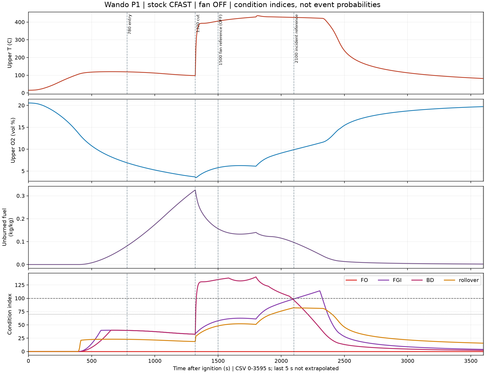
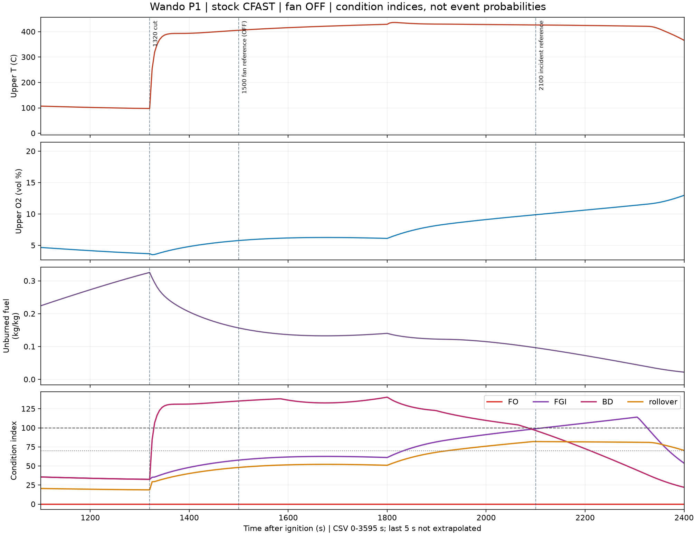

# C11 r2 P1 — 순정 CFAST 계산 및 조건 지수 보고

2026-11-02. P1만 시간 적분 1회. P2~P4, 간략 근사, 운영 화면 연결은 실행하지 않았다. 입력·결과를 2,100초에 맞춰 조정하지 않았다.

## 실행 상태

| 항목 | 값 |
|---|---|
| 엔진 | 순정 CFAST 7.7.7 baseline, 프로젝트 연소 확장 없음 |
| 엔진 SHA256 | `317cd8d1ae914152effe8733fe9fd49e0dc7284acdb041c7d9a57c77eb3467f9` |
| 계산 | 0~3,600초, `Normal exit from CFAST`, 총 70,789 단계 |
| 시간 | 외부 측정 **136.453초**, CFAST 자체 로그 135초 |
| 출력 | 5초 간격, 실제 CSV 0~**3,595초**. 마지막 5초는 미출력이며 보간·외삽하지 않음 |
| 로더 판정 | `invalid_native_output`: 3,600초 표본 없음. 정상 종료와 별도로 기록하며 완전한 재생 산출물 합격으로 처리하지 않음 |
| 입력 오류 이력 | 최초 호출은 CHEM 원소명을 축약한 작성 오류로 입력 읽기에서 종료(적분 0회). CARBON/HYDROGEN/OXYGEN/NITROGEN으로 표기만 고쳐 실행. **프로세스 호출 2회, 시간 적분 1회** |
| 동결 확인 | 엔진·조건표·덱 생성기·모델 기본값 SHA 불변. 전체 `conditions.evaluate()`와 본 보고의 4지수 값 일치 |

## 입력 조건

| 항목 | P1 입력·가정 |
|---|---|
| ROOM / CAVITY | 8.75×18×6.405 m / 8.75×0.10×6.405 m |
| 열경계 | 두 구획 벽·천장 PU 0.1 m, 바닥 콘크리트. 1·2절 물성 그대로 |
| 외기 문 | 2.5×3 m, 처음부터 완전 개방 |
| 공동 틈 | 하부 8.75×0.01 m, 상부 8.75×0.005 m. 추가 외피 누설 0 [가정] |
| 절단 개구 | x=1.75 m 중심 [가정], 높이 0.5~2.5 m. 1,320초 직후 폭 1 m, 1,800초 직후 폭 2 m |
| 개방 구현 | 순정 TIME VENT의 동일 시각 전·후 값. CSV에서 반개방 첫 관측 약 1,325초, 완전개방 1,805초 |
| 배풍기 / 바람 | OFF / 0. 그래프의 1,500초 선은 실제 사건 비교선이며 P1 급기 시작이 아님 |
| 초기 온도 | 실내·외 모두 15℃ [실내 초기값 가정] |
| 화학 | C=1, H=1.8, O=0.3, N=0.1; Hc=25 MJ/kg; soot=0.1; CO=0.05; 복사 분율 0.35 [기존 입력 기본값] |
| 연료 면적·에너지 | 112.0875 m², **9,807.656 MJ**. ROOM 전체 내장재 43,765 MJ를 추가 배정하지 않음 |
| 성장·상한 | slow α=0.00293; 면적 상한 44,835 kW |
| 유한 에너지 곡선 | 기존 `fire_curve` 기본: 70% 에너지까지 성장, 나머지 30% 선형 감쇠 [가정]. 실제 입력 peak **10,749.504 kW @ 1,915.404초**, 종료 2,462.833초. 곡선 적분 9,807.656 MJ |
| 화원 면적 | Q/400을 공동 바닥 0.875 m²로 제한 [등가 화원 가정]. 연료 재고 면적 112.0875 m²와 구분 |
| 수치 입력 | 최대 시간 간격 1초, CSV 5초, 실행 예산 1,800초. 엔진·솔버 코드 변경 없음 |

44.8 MW까지 slow 성장곡선을 무제한 지속하면 지정 에너지를 초과한다. 이번에는 기존 유한 연료 곡선의 감쇠 규칙을 입력 가정으로 사용했다. 이 선택은 3.3절에 직접 지정된 감쇠 규칙은 아니며, 사고 시각에 맞춘 보정도 아니다.

## 그래프

서로 단위가 다른 값은 공통 시간축의 4패널로 분리했다. 세로선은 780/1,320/1,500/2,100초. 지수 패널은 4종 중첩, 70·100 기준선 포함. 회색 끝부분은 마지막 5초 미출력 구간이다.

## ROOM 지수 최초 도달 시각

5초 표본에서 처음 기준 이상인 시각이다. 계산 시각의 미세한 부동소수 오차만 초 단위로 반올림했고, 표본 사이 사건 시각을 역산하지 않았다. 미도달은 **저장된 0~3,595초 범위**를 뜻한다.

| 현상 지수 | ≥70 | ≥100 | 최고 지수·시각 |
|---|---:|---:|---:|
| FO | 미도달 | 미도달 | 0.00 |
| FGI | **1,835초 (30:35)** | **2,120초 (35:20)** | 114.10 @ 2,305초 |
| 백드래프트 | **1,325초 (22:05)** | **1,330초 (22:10)** | 140.20 @ 1,800초 |
| 롤오버 조건 | **1,925초 (32:05)** | 미도달 | 82.04 @ 2,095초 |

FO=0은 안전 판정이 아니다. 기존 FO 점수의 연료 항은 해당 실 고체 화원+프로젝트 상층 추가연소 HRR이다. ROOM에는 이 화원을 등록하지 않았고 native DJET는 해당 항에 포함되지 않으므로 연료 항이 0이다. 분출 발열을 임의로 고체 HRR에 넣거나 조건표를 변경하지 않았다. 상층 온도 자체도 600℃ 미만이었다.

참고 CAVITY: FO 70·100 모두 1,330초, 백드래프트 70=500초·100=535초, FGI는 70 미도달, 롤오버 70=2,490초·100 미도달. 폭 0.1 m 공동의 조건 지수를 일반 실의 현상 예측으로 해석하지 않는다.

## CFAST 발열·연기층 결과와 2,100초 대조

| 항목 | 값 |
|---|---:|
| **CAVITY 실제 화원 HRR peak** | **2,155.634 kW @ 1,330초** |
| **ROOM 수신 door jet peak** | **6,461.767 kW @ 약 1,325초** |
| CAVITY 수신 door jet peak | 0 kW |
| 외기 수신 door jet peak | 8,957.453 kW @ 1,395초 |
| ROOM 상층 최고 온도 | 436.20℃ @ 1,815초 |
| CAVITY 상층 최고 온도 | 1,570.59℃ @ 2,350초 |
| ROOM 상층 최저 O₂ | 3.522 vol% |
| ROOM 미연 연료 최고 질량분율 | 0.325654 kg/kg @ 약 1,320초 |
| ROOM 연기층 3 m 이하 첫 표본 | 1,350초 (22:30) |
| ROOM 연기층 1.8 m 이하 | 미도달 |
| 2,100초 ROOM 상층 T / O₂ / 미연 연료 | 426.54℃ / 9.884 vol% / 0.096538 kg/kg |
| 2,100초 ROOM FO / FGI / BD / 롤오버 | 0 / **98.84** / 96.54 / 82.03 |
| FGI 100 시각 − 사고 비교 시각 | **+20초** |

**틈별·절단 개구별 발열 peak는 분리 미평가.** 순정 `outputspreadsheet.f90:1290` 이후 DJET는 `roomptr%qdot_doorjet`(받는 구획 합계)이다. ROOM 수신값은 공동 틈과 절단 개구에서 오는 분출 연소의 합계이며, 각 개구에 임의 배분하지 않았다. 위 최대값들도 5초 표본 최대이므로 순간 최대를 보장하지 않는다.

## 해석과 한계

- FGI 지수 100이 35분 20초라는 사실은 **FGI 착화 재현 성공이 아니다.** 이번 지수는 온도·미연 연료·산소 비율의 최솟값이다. 2,100초의 제한 요인은 O₂ 9.884%이며, 이후 O₂가 10%를 회복해 지수가 100을 넘는다. 지수 판정이 발열을 추가하거나 폭압·화염 전파를 계산하지 않는다.
- 큰 온도 상승과 ROOM 분출 발열 peak는 **1,320초 절단 직후** 발생했다. 실제 사건 비교 시각 2,100초에 새로운 급격 연소가 계산된 것은 아니다. FGI 지수 시각 하나의 근접성을 물리 검증으로 삼지 않는다.
- 0.1 m 두께의 긴 공동을 2존 구획으로 쓴 근사는 검증되지 않았다. CAVITY 상층 1,570.6℃, 국부 화원·방사·층 가정의 적용 한계를 함께 남긴다. 강판 자체 열전도·열분해 전파·벽 내 실제 유로는 풀지 않는다.
- 내장재 공급은 입력 곡선이며 온도 피드백 열분해가 아니다. 감쇠 에너지 배분, 화원 바닥 면적, 공동 틈·깊이, 성장률, 초기 문 상태가 결과에 영향을 줄 수 있다. 이번 실행 후 값은 변경하지 않았다.
- 순정 입력을 사용했다는 것과 실제 건물·FGI 시각에 대한 NIST 검증을 받았다는 것은 다르다. CO는 native 종 결과에 존재하지만 프로젝트 추가 CO 재연소를 켜지 않았다.
- 배풍기는 P1에서 의도적으로 OFF다. 절단 개구는 시간 가변으로 모델링했다. P2~P4 및 3.5절 근사는 미실행이다.
- 3.6절 경로·호스 비교 및 4절 운영 3D 연결은 이번 사용자가 지정한 P1 수치 보고 범위에서 진행하지 않았다.

## 재현 자료와 확인

- 입력·기록: [case.in](../../reviews/wando_C11_P1_20261102/case.in), [입력 증거](../../reviews/wando_C11_P1_20261102/input-evidence.json), [요약](../../reviews/wando_C11_P1_20261102/summary.json).
- [ROOM 시계열 CSV](../../reviews/wando_C11_P1_20261102/room-timeseries.csv), [4지수 요인 원값](../../reviews/wando_C11_P1_20261102/condition-scores.json), 원본 native CSV·로그 보존.
- [실행·후처리 도구](../tools/run_wando_c11_p1.py): prepare/run/analyze 분리. `attempt.json`이 있으면 추가 적분 실행을 거부한다. 후처리는 CFAST를 호출하지 않는다.
- 열·산소 결과 및 native 연소에는 후처리 영향 없음. 2실×4지수 모두 기존 전체 조건표 평가와 동일함을 확인했다.
- 엔진 정상 종료와 CSV 마지막 표본 누락을 구분했다. 완전한 3,600초 출력 확인을 위해 입력 시간을 연장하는 재실행은 하지 않았다.

**여기서 정지. P2는 사용자 승인 후 별도 1회.**
