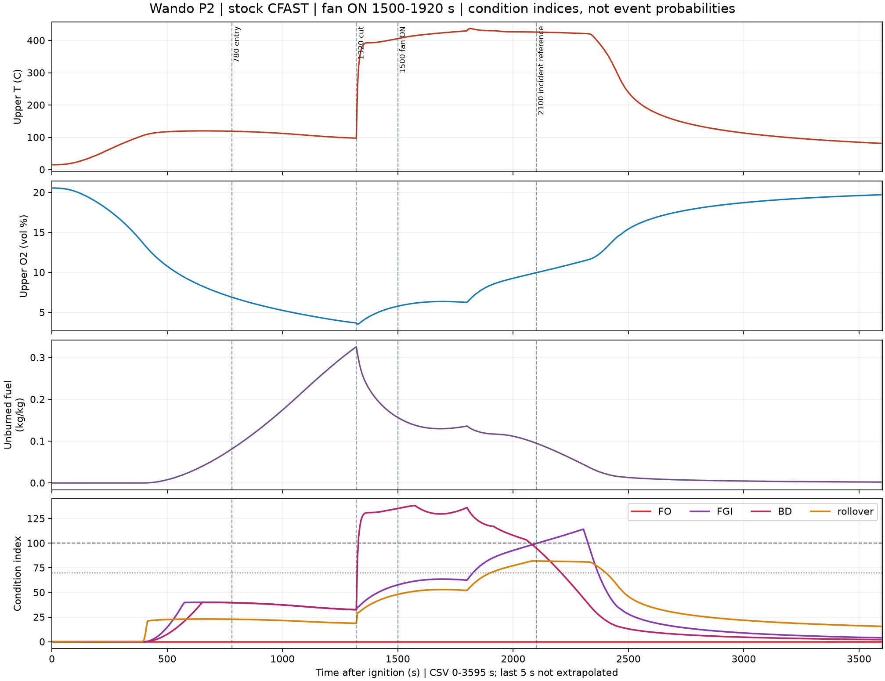
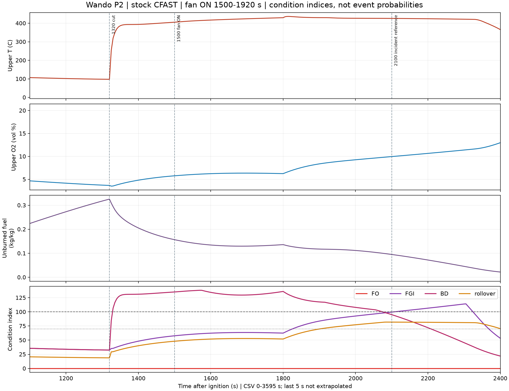
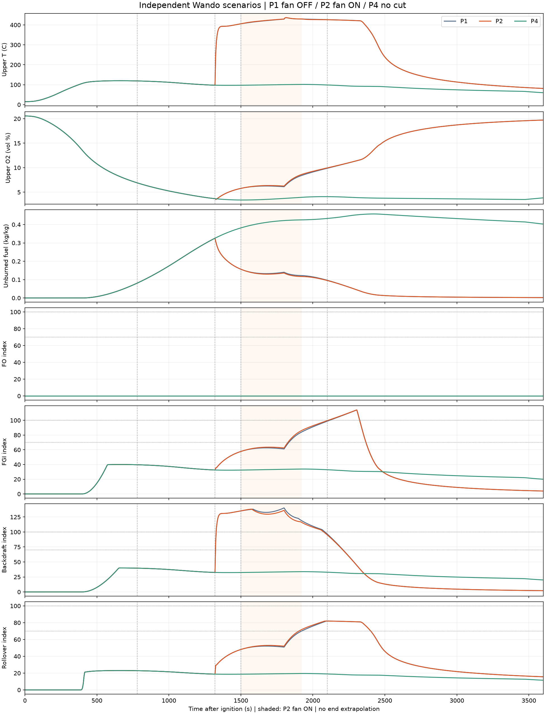

# C11 P2 — 배풍기 ON, 독립 CFAST 1회 및 P1·P4 비교

P2를 별도 폴더에 입력·실행·결과로 보존했다. P1(OFF), P4(OFF·절단 없음)는 저장 결과만 읽었으며 재계산·덮어쓰기하지 않았다. P3·간략 근사는 실행하지 않고 이 보고 후 정지한다.

## 실행 조건

| 항목 | P1 | P2 | P4 |
|---|---|---|---|
| 절단 | 1320/1800 s | P1과 동일 | 없음 |
| 급기 | OFF | 외기→ROOM, 10,000 m³/h, 1500~1920 s | OFF |
| 화원·재료·솔버·출력 | slow, 기존 입력 | P1과 동일 | P1과 동일 |
| 실행 수 | 기존 1회 | 이번 1회 | 기존 1회 |
| 외부 실행 시간(s) | 136.453 | 116.032 | 1166.125 |
| native 시간(s) | 135 | 114 | 1155 |
| 단계 수 | 70,789 | 71,295 | 671,279 |
| CSV 마지막(s) | 3595.0 | 3595.0 | 3595.0 |

P2 덱은 P1에 순정 `&VENT TYPE=MECHANICAL` 1줄만 추가했다. 명세의 MVENT 표현은 CFAST 7.7.7 실제 입력 문법으로 옮겼다. 엔진·조건표·연료·절단 일정·임계값 변경 없음.
급기구 양끝 면적 1 m², 수직 면, 중심 높이 1.5 m를 적용했다. 면적은 명세에 없어 [가정]이며, 층별 유입 배분에 영향을 줄 수 있다. 팬 압력 차단은 순정 기본 200/300 Pa를 유지했다. PPV의 공간 제트·문 주변 공기 유인은 계산하지 않는다.

실제 CSV 급기 확인: 최초 ON 표본 1,505 s (25:05), 마지막 ON 표본 1,920 s (32:00), ON 질량유량 절댓값 3.3782~3.3782 kg/s, OFF 구간 0.

## 그래프

기존과 같은 4패널: ROOM 상층 T·O₂·미연 연료 질량분율·4지수. 기준선 780/1320/1500/2100 s. 회색 끝 구간은 미출력이며 외삽하지 않았다.

## 지수 70·100 최초 도달

5초 출력에서 최초 기준 이상인 시각. 조건지수이며 현상 발생 확률·폭발/FGI 발생 확정이 아니다.

| 구획·지수 | P1 ≥70 / ≥100 | P2 ≥70 / ≥100 | P4 ≥70 / ≥100 |
|---|---|---|---|
| ROOM FO | 미도달 / 미도달 | 미도달 / 미도달 | 미도달 / 미도달 |
| ROOM FGI | 1,835 s (30:35) / 2,120 s (35:20) | 1,830 s (30:30) / 2,110 s (35:10) | 미도달 / 미도달 |
| ROOM 백드래프트 | 1,325 s (22:05) / 1,330 s (22:10) | 1,325 s (22:05) / 1,330 s (22:10) | 미도달 / 미도달 |
| ROOM 롤오버 조건 | 1,925 s (32:05) / 미도달 | 1,905 s (31:45) / 미도달 | 미도달 / 미도달 |
| CAVITY FO | 1,330 s (22:10) / 1,330 s (22:10) | 1,330 s (22:10) / 1,330 s (22:10) | 미도달 / 미도달 |
| CAVITY FGI | 미도달 / 미도달 | 미도달 / 미도달 | 미도달 / 미도달 |
| CAVITY 백드래프트 | 500 s (08:20) / 535 s (08:55) | 500 s (08:20) / 535 s (08:55) | 500 s (08:20) / 535 s (08:55) |
| CAVITY 롤오버 조건 | 2,490 s (41:30) / 미도달 | 2,490 s (41:30) / 미도달 | 미도달 / 미도달 |

## 지수 최고값·시각

| 구획·지수 | P1 | P2 | P4 |
|---|---:|---:|---:|
| ROOM FO | 0.000  @ 0 s (00:00) | 0.000  @ 0 s (00:00) | 0.000  @ 0 s (00:00) |
| ROOM FGI | 114.097  @ 2,305 s (38:25) | 114.143  @ 2,305 s (38:25) | 39.996  @ 660 s (11:00) |
| ROOM 백드래프트 | 140.200  @ 1,800 s (30:00) | 138.153  @ 1,570 s (26:10) | 39.996  @ 660 s (11:00) |
| ROOM 롤오버 조건 | 82.043  @ 2,095 s (34:55) | 81.944  @ 2,085 s (34:45) | 23.075  @ 660 s (11:00) |
| CAVITY FO | 110.267  @ 1,330 s (22:10) | 110.267  @ 1,330 s (22:10) | 49.373  @ 395 s (06:35) |
| CAVITY FGI | 19.894  @ 2,630 s (43:50) | 19.648  @ 2,635 s (43:55) | 16.570  @ 2,910 s (48:30) |
| CAVITY 백드래프트 | 354.249  @ 1,800 s (30:00) | 347.052  @ 1,800 s (30:00) | 331.601  @ 765 s (12:45) |
| CAVITY 롤오버 조건 | 82.362  @ 2,490 s (41:30) | 82.660  @ 2,490 s (41:30) | 15.410  @ 395 s (06:35) |

## CFAST 대조

| 항목 | P1 | P2 | P4 |
|---|---:|---:|---:|
| CAVITY 실제 화원 HRR peak | 2,155.634 kW @ 1,330 s (22:10) | 2,189.711 kW @ 1,920 s (32:00) | 445.037 kW @ 395 s (06:35) |
| ROOM 수신 door jet peak | 6,461.767 kW @ 1,325 s (22:05) | 6,461.763 kW @ 1,325 s (22:05) | 0.000 kW @ 0 s (00:00) |
| ROOM 상층 T peak | 436.200 ℃ @ 1,815 s (30:15) | 436.650 ℃ @ 1,815 s (30:15) | 119.989 ℃ @ 660 s (11:00) |
| CAVITY 상층 T peak | 1,570.594 ℃ @ 2,350 s (39:10) | 1,570.569 ℃ @ 2,350 s (39:10) | 1,048.714 ℃ @ 590 s (09:50) |
| ROOM 미연 연료 peak | 0.326 kg/kg @ 1,320 s (22:00) | 0.326 kg/kg @ 1,320 s (22:00) | 0.458 kg/kg @ 2,420 s (40:20) |
| 외기 수신 door jet peak | 8,957.453 kW @ 1,395 s (23:15) | 8,957.617 kW @ 1,395 s (23:15) | 0.000 kW @ 0 s (00:00) |
| ROOM 최저 O₂ (vol%) | 3.522 | 3.522 | 3.401 |
| ROOM 경계 ≤3 m | 1,350 s (22:30) | 1,350 s (22:30) | 2,315 s (38:35) |
| ROOM 경계 ≤1.8 m | 미도달 | 미도달 | 미도달 |

## 2100초 비교

| 값 | P1 | P2 | P4 |
|---|---:|---:|---:|
| T_upper_C | 426.5388 | 425.9359 | 98.7217 |
| O2_upper_vol_percent | 9.8842 | 9.9602 | 4.0821 |
| fuel_upper_mass_fraction | 0.0965 | 0.0951 | 0.4332 |
| interface_m | 2.3722 | 2.3704 | 3.2483 |
| FO | 0.0000 | 0.0000 | 0.0000 |
| FGI | 98.8419 | 99.6020 | 32.9072 |
| BD | 96.5382 | 95.0811 | 32.9072 |
| rollover | 82.0267 | 81.9107 | 18.9849 |

## 차이·한계

- P1 대비 ROOM 최고 T 436.2→436.6℃, FGI 100 2,120 s (35:20)→2,110 s (35:10).
- ROOM door jet 최대는 두 경우 모두 1325초로 팬 ON(1500초) 이전이다. 최대값이 같다는 것만으로 팬 가동 중 영향이 없었다고 판단하지 않는다.
- P4 대비 ROOM 최고 T 120.0→436.6℃. P4와 P2는 절단과 급기 두 조건이 달라 팬 단독 효과로 해석하지 않는다.
- 팬 이전 ROOM T 최대 차이 0.00717612℃, O₂ 0.000399151%p. 입력 추가에 따른 수치 편차를 그대로 기록했다.
- 명목 ON/OFF는 고정 입력이다. 유입 산소 증가와 냉각·희석·미연 가스 연소가 함께 작용하므로, 결과는 이 입력의 비교이며 배풍 일반의 효과를 입증하지 않는다.
- ROOM FO 지수는 기존 식의 고체+bulk 발열 0 때문에 0이다. native DJET를 고체 발열로 재배정하지 않았다. DJET는 받는 구획 합계로 틈·절단 개별 분리 불가.
- 순정 정상 종료와 3600초 CSV 끝 표본 유무는 별개다. 마지막 3595초이면 기존 로더의 horizon 검사 실패를 보존하고 5초를 채우지 않았다.
- 실행 시간은 이번 1회 관측이다. P2 단계 수는 P1보다 조금 많으므로 116초 대 136초를 일반적인 속도 개선으로 해석하지 않는다.
- 0.1 m 공동 2존 근사, 내장재 바닥 등가 화원, 강제 공급 포트 면적은 사례 검증되지 않은 가정이다. 실제 2100초 사건에 맞춘 조정 없음.

자료: [입력 diff](../../reviews/wando_C11_P2_20261102/P1-P2-input.diff) · [비교 JSON](../../reviews/wando_C11_P2_20261102/P1-P2-P4-comparison.json) · [급기 출력 확인](../../reviews/wando_C11_P2_20261102/fan-verification.json) · [P1·P4 기존 파일 불변](../../reviews/wando_C11_P2_20261102/baseline-independence.json).

**P2 1회 보고 후 정지. P3 미실행.**
