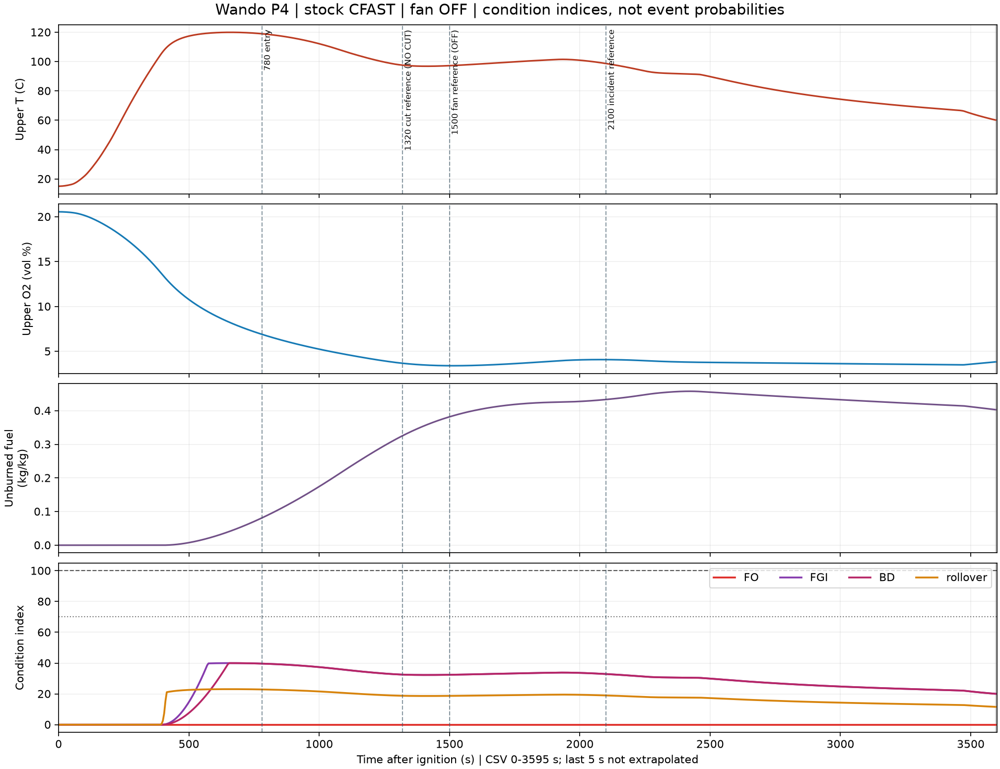
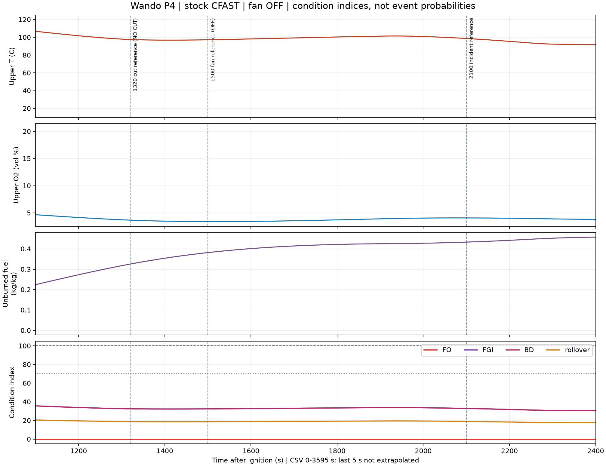

# C11 r2 P4 — 절단 없음, CFAST 1회 결과

P4만 시간 적분 1회 실행했다. P2·P3·간략 근사는 실행하지 않고 여기서 정지한다.

P4는 운영 연결 우선 요청 전에 이미 시작한 실행이다. 연결 완료 후 저장 출력만 분석했으며 재실행하지 않았다. 실행 이후 명세 파일은 r3으로 갱신됐으나, 실행 당시 입력 덱·엔진·조건표·물리 코드의 해시는 그대로다. 명세 해시 차이는 summary.json의 unchanged에 false로 보존했다.

**P1 대비: ROOM 최고 온도 436.2→120.0℃, ROOM door jet peak 6461.8→0.0 kW, FGI 100 도달 2,120초 (35:20)→미도달.**

## 실행 조건

| 항목 | P4 |
|---|---|
| P1과 다른 입력 | CUT 개방 일정만 `T=0 F=0`. 기존 1,320/1,800초 절단·확대 없음 |
| 동일성 | 덱 1줄만 변경. 모델의 CUT schedule 이외 전체 필드 동일 검증 |
| 유지 입력 | slow α=0.00293, 총 9,807.656 MJ, 공급 peak 10,749.504 kW, 70% 성장·30% 감쇠 가정, 하부·상부 틈 개방, 외기 문 개방, 배풍기 OFF |
| 엔진 | 순정 CFAST baseline, SHA256 `317cd8d1ae914152effe8733fe9fd49e0dc7284acdb041c7d9a57c77eb3467f9` |
| 시간 | 외부 1166.125초 / native 1155초 / 671,279 단계 |
| 종료·출력 | native 정상 종료, 요청 3,600초. CSV 마지막 3595초. 마지막 5초를 외삽하지 않음 |
| 로더 | P1과 동일하게 마지막 3,600초 표본이 없어 엄격한 horizon 검사는 실패. 재계산하지 않음 |
| 검증 | CUT WF 전 구간 0, 조건표 전체 evaluate와 4지수 동일, 엔진·조건표·물리 입력 생성 코드 SHA 불변 |

## 그래프

세로선 780/1,320/1,500/2,100초를 유지했다. P4의 1,320초는 **절단을 실행하지 않은 비교선**, 1,500초 역시 배풍기를 켜지 않은 비교선이다.

## ROOM 지수 최초 도달

5초 native 출력 표본의 최초 기준 이상 시각. 미도달은 저장 구간에 한하며 발생확률이나 실제 현상 발생 판정이 아니다.

| 지수 | ≥70 | ≥100 | 최고 지수·시각 |
|---|---:|---:|---:|
| FO | 미도달 | 미도달 | 0.00 @ 0초 (00:00) |
| FGI | 미도달 | 미도달 | 40.00 @ 660초 (11:00) |
| 백드래프트 | 미도달 | 미도달 | 40.00 @ 660초 (11:00) |
| 롤오버 조건 | 미도달 | 미도달 | 23.07 @ 660초 (11:00) |

## CFAST 대조

| 항목 | P1 절단 있음 | P4 절단 없음 |
|---|---:|---:|
| CAVITY 실제 화원 HRR peak | 2,155.634 kW @ 1,330초 (22:10) | 445.037 kW @ 395초 (06:35) |
| ROOM 수신 door jet peak | 6,461.767 kW @ 1,325초 (22:05) | 0.000 kW @ 0초 (00:00) |
| 외기 수신 door jet peak | 8,957.453 kW @ 1,395초 (23:15) | 0.000 kW @ 0초 (00:00) |
| ROOM 상층 T peak | 436.200 ℃ @ 1,815초 (30:15) | 119.989 ℃ @ 660초 (11:00) |
| CAVITY 상층 T peak | 1,570.594 ℃ @ 2,350초 (39:10) | 1,048.714 ℃ @ 590초 (09:50) |
| ROOM 상층 최저 O₂ | 3.522% | 3.401% |
| ROOM 상층 미연 연료 최대 질량분율 | 0.325654 | 0.457802 |
| ROOM 경계 3 m 이하 | 1,350초 (22:30) | 2,315초 (38:35) |
| ROOM 경계 1.8 m 이하 | 미도달 | 미도달 |

## 2,100초 비교

| 값 | P1 | P4 |
|---|---:|---:|
| 상층 T(℃) | 426.5388 | 98.7217 |
| 상층 O₂(vol%) | 9.8842 | 4.0821 |
| 미연 연료(kg/kg) | 0.0965 | 0.4332 |
| 연기 경계(m) | 2.3722 | 3.2483 |
| FO | 0.0000 | 0.0000 |
| FGI | 98.8419 | 32.9072 |
| 백드래프트 | 96.5382 | 32.9072 |
| 롤오버 조건 | 82.0267 | 18.9849 |

## CAVITY 지수 참고

| 지수 | ≥70 | ≥100 | 최고 지수·시각 |
|---|---:|---:|---:|
| FO | 미도달 | 미도달 | 49.37 @ 395초 (06:35) |
| FGI | 미도달 | 미도달 | 16.57 @ 2,910초 (48:30) |
| 백드래프트 | 500초 (08:20) | 535초 (08:55) | 331.60 @ 765초 (12:45) |
| 롤오버 조건 | 미도달 | 미도달 | 15.41 @ 395초 (06:35) |

## 해석 범위

- P4는 절단만 없앤 입력 대조다. 결과를 맞추기 위한 성장률·에너지·임계값·솔버 변경은 없다.
- 저산소·미연 연료 축적이 있어도 온도 등 다른 요인이 기준보다 낮으면 AND 지수는 낮다. 낮은 지수가 추후 개방 안전을 보증하지 않는다. 이번 P4는 나중에 문이나 강판을 여는 개입을 계산하지 않았다.
- ROOM FO 지수는 기존 식에서 해당 실 고체+프로젝트 bulk 발열을 쓰므로 0이다. native DJET를 임의 재배정하지 않았다. 이 항의 한계는 P1과 동일하다.
- DJET는 받는 구획 합계다. P4는 절단이 닫혀 있으므로 ROOM 수신 발열이 있으면 상·하부 틈 경로 합계다. 두 틈의 개별 peak는 순정 출력에 없어 분리 미평가다.
- 공동 두께 0.1 m의 2존 근사, 등가 바닥 화원 면적, 입력 성장·감쇠 곡선은 검증된 실제 내장재 화재 재현이 아니다. 지수는 FGI·폭압·화염 전파 발생을 계산하는 모델이 아니다.
- 도달 시각·peak는 5초 표본 기준이다. 마지막 5초 출력 누락을 숨기거나 새 표본으로 채우지 않았다.

자료: [입력 차이](../../reviews/wando_C11_P4_20261102/P1-P4-input.diff), [P1 비교 JSON](../../reviews/wando_C11_P4_20261102/P1-comparison.json), [ROOM CSV](../../reviews/wando_C11_P4_20261102/room-timeseries.csv).

**P4 보고 후 정지. 다음 순서는 P2 → P3이며 아직 실행하지 않았다.**
