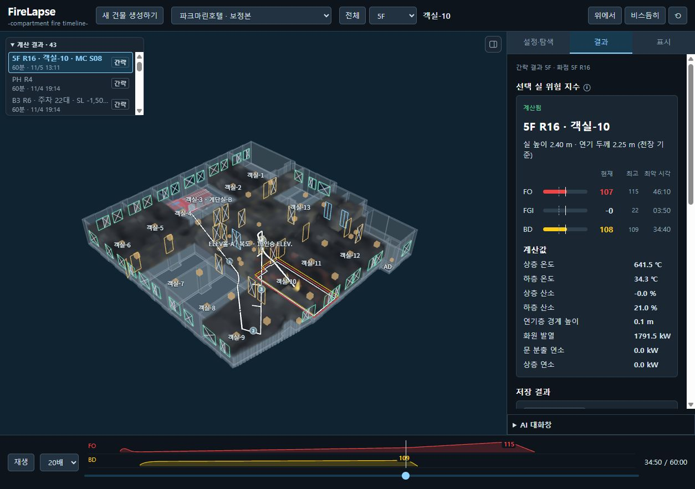
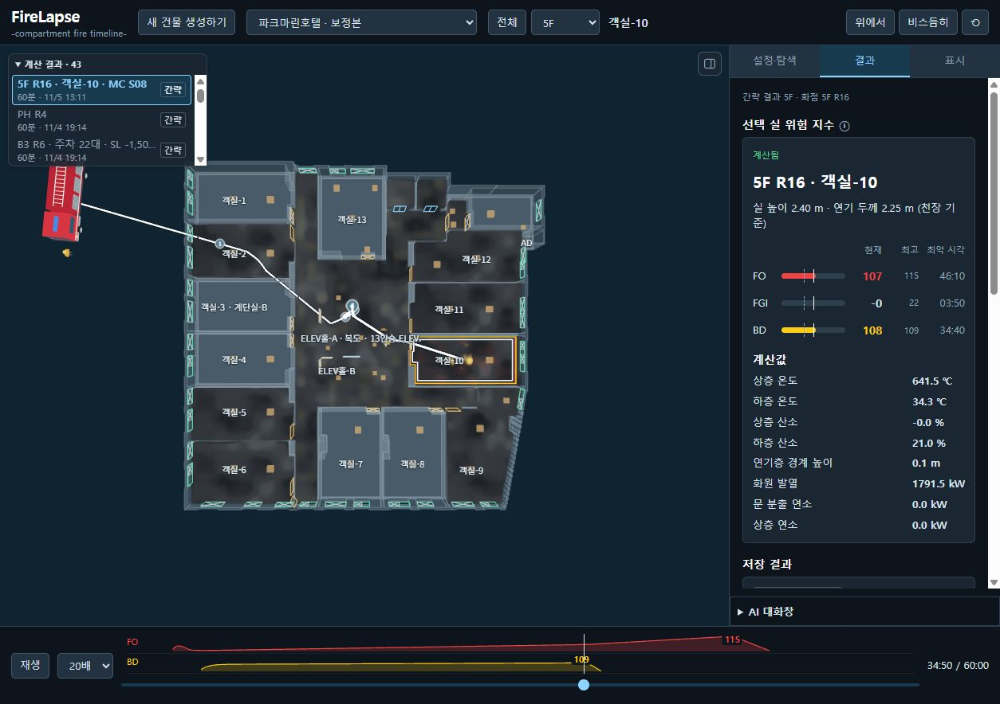
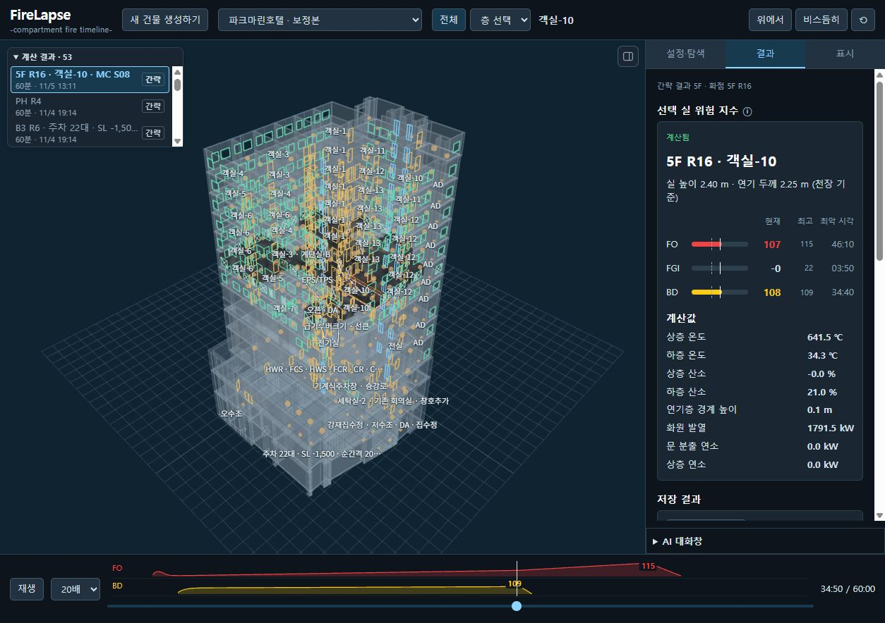
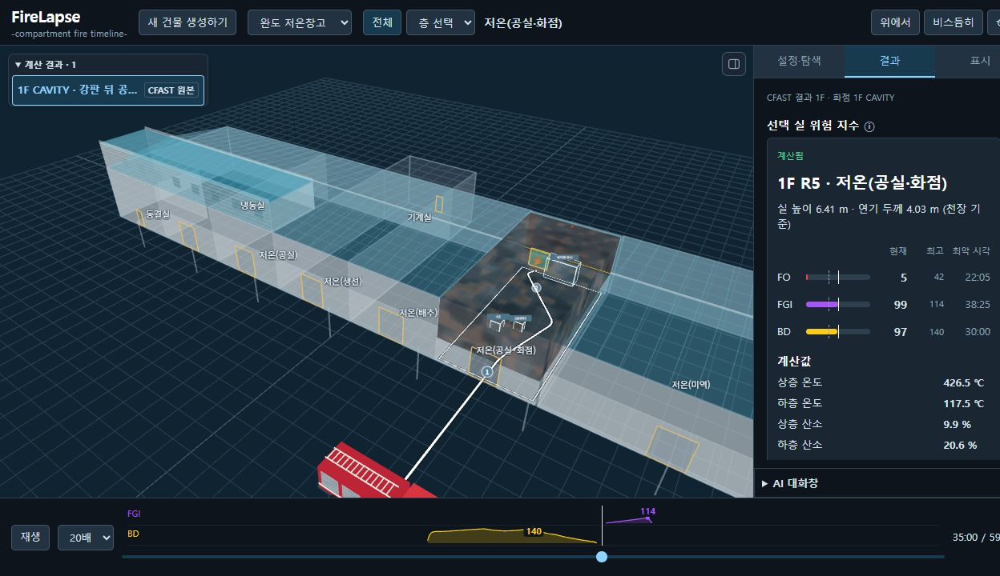

# FireLapse
### -compartment fire timeline-

**3D 건물 모델에서 구획 화재의 진행과 위험 조건을 시간에 따라 살펴보는 Windows용 로컬 앱입니다.**

최신 실행 패키지 `v2026.11.10-r18`에는 7개 건물 모델, 기본 입력 수정 후 다시 계산한 CFAST 결과 4건(호텔 5F·B1, 강화 공장 2F, 아이엔테크놀로지 1F), 기존 MC 결과가 포함됩니다. 그 밖의 과거 계산·기본 샘플은 새 패키지에서 제외했습니다. 기존 PC의 공용 결과 폴더는 업데이트할 때 삭제하지 않습니다.

**계산 대상 시간: 30분 또는 최대 60분(1시간) · 기본값: 60분**

이는 시뮬레이션 속 화재 진행 시간입니다. PC에서 실제 계산을 완료하는 데 걸리는 시간은 건물과 엔진에 따라 달라집니다.

[배포 파일 확인](https://github.com/secret5028/firelapse/releases/tag/v2026.11.10-r18) · [소스 코드](https://github.com/secret5028/firelapse)

## 화면 미리보기

아래 두 HTML은 r18에 포함된 CFAST 결과에 **결과 요약을 포함한 단독 실행 샘플**입니다. 다운로드한 파일을 브라우저에서 열면 인터넷·API 연결 없이도 **결과 탭 맨 아래의 결과 요약**을 볼 수 있습니다. 호텔 B1을 포함한 CFAST 4건과 MC는 실행 패키지에서 확인할 수 있으며, B1의 입력 확인 필요(`unverified`) 상태는 유지합니다.

- [호텔 · 5F R16 HTML 다운로드 — 결과 요약 포함](https://github.com/secret5028/firelapse/releases/download/v2026.11.10-r18/FireLapse-parkmarine-5F-R16-route-v2.html)
- [아이엔테크 · 1F R3 HTML 다운로드 — 결과 요약 포함](https://github.com/secret5028/firelapse/releases/download/v2026.11.10-r18/FireLapse-intech-1F-R3-route-v2.html)

아래 이미지는 이전 실행 화면을 보관한 것으로, 위 최신 CFAST 샘플과 구분됩니다. 호텔 이미지는 간략 엔진 결과, 완도 이미지는 전용 CFAST P1 결과입니다.

### 호텔 · 층별 결과와 위험 지수



### 호텔 · 위에서 본 평면과 수관 경로



### 호텔 · 전체 건물



### 완도 · 순정 CFAST 35분, R5 선택



## 주요 기능

- **건물 탐색:** 건물·층 선택, 실 이름, 계단·승강기, 문·창과 개폐 상태 표시
- **가연물 설정:** 층 전체 양 조절, 실별 연료 기준·양 설정, 개별 설정 유지
- **화점 선별:** 연료량·환기 부족·화재 확산 연결을 고려한 후보 상위 5개 확인
- **MC 급기 탐색:** 여러 개구부 상태 조합을 계산하고 선택 기준에 따른 최악 표본 적용
- **CFAST 단일 계산:** 단일 계산과 MC의 모든 표본을 같은 순정 CFAST 실행 경로로 계산
- **시간별 재생:** 연기·화염, 온도·산소, FO·FGI·BD 지수와 최고 시각 확인
- **진입 경로:** 소방차 위치와 선택 실을 잇는 수관 경로 표시
- **결과 공유:** 현재 사례를 단독 재생 HTML로 내보내기
- **선택적 AI 연결:** 사용자 API를 연결한 대화·가연물 제안·도면 검토

## 내려받아 실행하기

1. 이 페이지에서 **Code → Download ZIP**을 누릅니다.
2. ZIP을 **모두 압축 풀기**한 뒤 최상위 폴더의 `FireLapse.cmd`를 더블클릭합니다.
3. 첫 실행 때 실행 패키지를 내려받아 `%LOCALAPPDATA%\FireLapse\releases`에 풀고, 바탕화면에 **FireLapse** 바로가기를 만듭니다. 이후에는 그 바로가기로 실행할 수 있습니다.
4. 바탕화면 아이콘을 누르면 Chrome 또는 Microsoft Edge에서 FireLapse 전용 창이 열립니다. 빨간 **종료** 버튼이나 창의 **X**로 닫으면 로컬 서버도 종료됩니다. 계산 중에 **X**로 창을 닫으면 계산을 마친 뒤 서버가 종료됩니다.

오프라인 PC에 옮기거나 폴더 위치를 직접 지정하려면 [Windows 실행 패키지 ZIP](https://github.com/secret5028/firelapse/releases/tag/v2026.11.10-r18)을 따로 받아 모두 압축을 푼 뒤, 그 안의 `FireLapse.cmd`를 실행합니다.

실행 패키지에는 Python·Node·필수 라이브러리와 계산 실행 파일이 포함됩니다. 저장된 모델과 결과를 보는 데 별도 API 키나 AI 계정은 필요하지 않습니다.

설치기를 통한 업데이트는 새 설치본 검사에 통과하면 현재 버전과 직전 버전만 남깁니다. 실행 중인 구버전은 다음 설치기 실행 때 정리하며, 별도 `FireLapse/results` 폴더의 계산 결과는 삭제하지 않습니다. 직접 압축을 푼 휴대용 폴더는 자동 정리 대상이 아닙니다.

### 실행 환경

| 항목 | 내용 |
|---|---|
| 운영체제 | Windows 10/11, x64 |
| 화면 | WebGL 지원 Edge 또는 Chrome |
| 실행 방식 | 압축 해제 후 실행하는 로컬 앱 |
| 접속 | 이 PC의 `127.0.0.1`; 인터넷 공개 서버가 아님 |
| 사용 포트 | 8780, 8832, 8841~8844 |
| 점검 | `Check-FireLapse.cmd`로 모델 파일·의존성 확인 |
| 용량 | 최종 ZIP과 압축 해제 크기는 Release 안내 참조 |

브라우저가 자동으로 열리지 않으면 기본 호텔 화면인 `http://127.0.0.1:8842/model.html`을 열 수 있습니다. 앱이 실행 중인 PC에서만 접속할 수 있습니다.

## 포함 건물

| 건물 | 제공 범위 |
|---|---|
| 강화 공장 | CAD 기반 3D, 저장 결과, 입력 검사를 통과한 층의 계산 |
| 파크마린호텔 | CAD 기반 층별 3D, 저장 결과, 층별 계산 |
| 완도 저온창고 | 재구성 모델, 전용 CFAST P1 재생, P1·P2·P4·P5 최종 요약 자료 |
| 견본주택 | CAD 기반 3D, 저장 결과, 입력 검사를 통과한 층의 계산 |
| 강화 공동주택 101동 | 스캔 기반 3D 열람 전용 |
| 모도리 267 | 스캔 기반 3D 열람 전용 |
| 아이엔테크놀로지 | CAD 기반 1F·2F 모델, 저장 결과, 층별 계산 |

스캔 기반 건물은 개구부 정보가 검증되지 않아 시뮬레이션을 지원하지 않습니다. 추정한 연결·층고는 모델의 검토 표시와 함께 확인하세요. 완도는 일반 CAD 계산과 구분된 전용 입력·재생 경로를 사용하며, 전용 화면의 HTML 내보내기는 비활성입니다.

## 2026-11-08 층별 CFAST 재계산

호텔 14개 층, 강화 공장 9개 층, 아이엔테크놀로지 2개 층에서 기존 화점 후보 순위가 가장 높은 실을 하나씩 골라 총 25건을 추가했습니다. 각 사례는 **순정 CFAST 7.7.7로 화재 진행 60분 전체를 새로 계산**하며, 이번 묶음에서는 MC 탐색을 다시 실행하지 않습니다. 해당 화점실에 저장된 확정 개폐 조건이 있으면 사용하고, 없으면 앱 기본 개폐 조건을 사용합니다.

- [층별 계산 입력·지수·물리 타당성 검사 내역](PyroCast/saved_results/floor-samples-20261108/manifest.json)
- [공유 결과 파일의 원본 SHA-256 목록](PyroCast/saved_results/floor-samples-20261108/files.json)
- 이번 25건의 타당성 검사: **23건 통과, 호텔 B1·B2 2건 미통과**. 두 미통과 사례는 미연소 연료 비율·연소 비율 기준을 벗어났으며 진단용으로 보존합니다.
- 결과는 새 사례로 추가하며 기존 계산 파일은 교체하지 않습니다. 타당성 검사를 통과하지 않은 사례는 그 사유를 표시하고 지수·전술 권고를 숨깁니다.
- 화점실 바닥 복사열 측정점은 64개입니다. 화면용 재생 파일은 소수점 5자리로 저장하고, 분석 결과는 원래 정밀도를 유지합니다. 저장소의 `.gz`는 이 25건의 보관본입니다. 현재 실행 패키지는 위 4건과 MC, 완도 전용 P1 결과를 포함하며 25건 전부를 중복 포함하지 않습니다.
- 호텔 B1의 비대칭 문 기호 폭과 작은 구획의 계산 형상을 보정했습니다. 실제 지정된 큰 개구부는 면적을 보존하는 병렬 계산 개구부로 변환하며 원본 CAD는 바꾸지 않습니다.

## 저장 결과 보기

1. 상단에서 건물을 선택합니다.
2. 3D 화면에서 계산값이 있는 방을 클릭하면 **결과** 탭에서 그 방의 값이 열립니다. 지수가 가장 높았던 셀과 시각에 재생을 멈춥니다.
3. 다른 사례를 골라 보려면 **3D 화면 왼쪽 위 결과 목록**을 사용합니다. 현재 보는 결과가 강조되며, r19 배포본의 저장 결과는 `CFAST 원본`으로 표시됩니다.
4. 아래 시간 막대를 움직이거나 재생 버튼을 누릅니다.
5. 클릭한 실의 최신 화점 사례를 우선 엽니다. 해당 실이 화점이었던 사례가 없으면 현재 사례의 값을 사용하고, 현재 사례에 값이 없으면 그 실이 포함된 최신 완료 사례를 엽니다. 저장 자료가 없는 실은 **`—`**로 나타납니다.
6. 내보내기를 지원하는 사례에서는 결과 탭의 **HTML 내보내기**로 단독 재생 파일을 저장합니다. 이 파일은 보기용이며 새 계산은 실행하지 않습니다.

일부 CFAST 대조 자료는 최종 요약 JSON으로 제공되며 재생 목록에 모두 나타나는 것은 아닙니다.

완료 사례를 열면 **결과** 탭 맨 위에 **선택 실 위험 지수**, 맨 아래에 **결과 요약**이 표시됩니다. 포함 사례에는 요약이 들어 있으며, 새 계산은 완료 후 요약을 자동으로 저장합니다. 요약은 **화재 위험 요약 → 수관 구간별 할 일 → 공통** 순서입니다. 화점의 저장 입력을 먼저 보여주고, 각 수관 구간은 경로·상태·매칭된 교재 규칙을 구분합니다. 경로 또는 실의 저장 데이터가 없으면 미평가로 표시합니다.

## 새 계산하기

`설정·탐색`에서 화면의 단계 순서대로 진행합니다.

1. **층 선택:** 계산할 층 하나를 선택합니다.
2. **가연물 설정:** 층 전체 양을 조절합니다. 실을 클릭하면 개별 연료 기준과 양을 바꿀 수 있습니다. 개별 설정한 실은 층 전체 변경을 따라가지 않습니다.
3. **화점 확인:** 후보 상위 5개와 점수를 확인하고 화점실을 선택합니다.
4. **CFAST MC 급기 탐색:** 계산 시간과 표본 수를 설정합니다. 모든 표본을 CFAST로 계산합니다. CAD 건물 라이브러리에서는 화점실마다 독립적인 무작위 조합을 탐색합니다.
5. **급기 상태 적용:** 선택된 최악 표본과 문·창 상태를 확인합니다. 라이브러리의 적용 상태는 화점실별로 저장합니다.
6. **CFAST 계산:** **계산하기**를 누릅니다. 유효한 완료 MC 조합이 있으면 그 입력을 사용하고, MC가 없으면 앱의 기본 개구부 입력으로 실행합니다. 선택한 개폐 조합과 화원 입력으로 CFAST를 실행합니다. 기존 간략 계산 결과를 새 계산으로 재사용하지 않습니다.

**이번 계산의 화원 입력**에서 화점실 전체 가연물 총량(GJ)과 초기 화점 셀의 최대 발열률(MW)을 각각 지정할 수 있습니다. 입력을 지정하면 선택한 MC 조합의 개폐 상태로 CFAST를 새로 실행합니다. 결과에서 입력 발열률과 계산 중 기록된 최고 발열률을 확인할 수 있습니다.

| 구분 | 의미 |
|---|---|
| 화점 후보 점수 | 상세 계산 전에 위험해 보이는 실을 선별하는 지표 |
| MC | 여러 급기·개구부 조합을 표본으로 탐색하는 방법 |
| 기존 간략 결과 | r19 실행 패키지에서 제외. 개발 원본과 간략 엔진 코드는 보존 |
| 순정 CFAST | CFAST 입력으로 변환해 기준 실행 파일로 계산 |

MC 자체가 별도의 물리 엔진은 아닙니다. 최악 표본은 **실제로 탐색한 조합과 선택 기준 안에서의 결과**입니다. 개발 원본의 과거 간략 결과는 수정·재계산하지 않지만 r19 실행 패키지에는 넣지 않습니다. 과거 간략 결과가 내장된 단독 HTML 샘플도 패키지에서 제외합니다. 새 MC에서는 물리 타당성 검사에 실패한 표본을 최악 순위와 비율의 분모에서 제외하고 제외 수를 따로 기록합니다.

CAD 지하층의 외기 직접 누기 기본값은 0입니다. 도면의 출입구·램프·샤프트와 지정한 누기를 CFAST 입력으로 사용합니다. 생략된 건물 연결의 최소 누기와 지하 압력 경계는 계산 가정으로 표시합니다. 실제 단열과 지중 열경계는 별도 입력 근거가 필요합니다.

급·배기 간략식은 `Q = ACH × 실 체적 / 3600` (m³/s)으로 유량만 산정합니다. 온도·산소·연기·연소는 지상과 지하 모두 CFAST가 계산합니다. 0 ACH는 팬 정지이며, 설비 정보가 없다고 6 ACH나 외부 창을 자동 추가하지 않습니다.

저환기 조건은 계산이 오래 걸릴 수 있습니다. 실제 해석 시각과 경과시간을 표시하며, 반올림된 해석 시각이 같아도 적분 단계가 증가하면 진행 중으로 판단합니다. 계산당 최대 실행 시간과 실제 정지 감시 시간은 `PyroCast/config/physics_defaults.json`의 `native_execution`에서 설정합니다. 시간 한도를 넘긴 부분 결과를 완료 결과로 저장하지 않습니다.

## 지수와 표시 읽기

| 표시 | 의미 |
|---|---|
| FO | 플래시오버 관련 조건 충족 지수 |
| FGI | 가연성 화재 가스의 점화 관련 조건 충족 지수 |
| BD | 고온 연기 축적·산소 부족 등 백드래프트 관련 조건 충족 지수 |
| 100 | 앱에서 정의한 조건 기준에 도달 |
| 롤오버 조건 충족 | 상층 연소·산소·온도 조건으로 독립 판정하는 상태; FO·FGI·BD와 별도로 표시 |
| 연기 두께 | 천장에서 상층·하층 경계까지의 두께 |
| `—` | 계산 자료가 없거나 해당 항목이 미평가됨 |

지수는 발생 확률이 아닙니다. 100에 도달했다고 실제 현상이 발생했다고 확정하지 않으며, **계산된 0과 미평가 `—`를 구분**합니다.

3D에서는 FO 빨강, FGI 보라, BD 노랑을 사용합니다. 수관은 흰색, 계단·승강기는 청색 계열, 실내 문은 금색, 외부 창은 청록색입니다.

## 새 CAD와 AI

**포함된 7개 건물은 추가 CAD 도구 없이 열 수 있습니다.** 새 DWG·DXF로 모델을 만들려면 별도 CAD 추출 도구·변환기와 `config/cad-import.local.json` 설정이 필요합니다. 예시는 `config/cad-import.example.json`에 있습니다.

- 새 건물 생성에서 CAD 파일을 추가하고 건물 이름·층 구성·검토 항목을 확인합니다.
- 누락 층이나 심각한 결측이 있으면 생성·계산이 제한됩니다.
- 확실한 기하 보정은 자동 적용하고 애매한 공간·연결은 추정 또는 미확인으로 남깁니다.
- 상단 **AI 대화** 버튼을 누르면 대화창이 열립니다. 저장 사례를 선택한 뒤 **결과 요약**을 누르면 API 연결 없이도 저장 데이터로 브리핑을 볼 수 있습니다.
- AI에 질문하려면 `설정·탐색 → AI 연결`에서 API 주소·모델·키를 입력합니다.
- 이미지 판독에는 실제로 이미지를 처리하는 모델과 호환 API가 필요합니다. 단순 연결 성공만으로 도면 판독 성공을 보장하지 않습니다.
- 연결 키는 서버 메모리에 보관되므로 앱을 재시작하면 다시 연결해야 합니다. 제작자의 API 키는 배포하지 않습니다.

새 CAD를 API AI로 자동 보정하고 검증하는 전체 과정은 **통합 검증 미완료**입니다. 어떤 CAD든 동일한 품질로 모델·계산 입력이 생성된다고 보증하지 않습니다. AI 미연결 상태의 용도별 기준 배치를 실제 AI 검토 완료로 해석하지 마세요.

## 저장 위치와 용량 관리

```text
FireLapse/
  FireLapse.cmd               앱 실행
  Check-FireLapse.cmd         구성 점검
  README.md                  사용 설명서
  THIRD_PARTY_NOTICES.md      구성요소·라이선스 안내
  distribution.json          배포 정보
  files.sha256.json           파일 무결성 목록
  runtime/                   Python·Node 실행 환경
  app/config/                건물 목록·앱 설정
  app/data/                  건물 모델
  app/cad-project/           강화 모델·공통 3D 리소스
  app/simulation/config/     계산 설정
  app/simulation/results/    배포에 포함된 기존 저장 결과
  # 새 계산 결과·서버 로그는 아래 외부 데이터 폴더에 저장
```

첫 배포에는 최종 재생 결과와 재계산에 필요한 모델·설정·엔진을 포함합니다. 대용량 중간 행렬·원본 CSV·개발 로그·시험 캡처는 제외합니다. 결과 수치는 패키징을 위해 다시 계산하거나 변경하지 않습니다.

새 계산 결과는 **`%LOCALAPPDATA%\FireLapse\results`**, 실행 로그는 **`%LOCALAPPDATA%\FireLapse\logs`**에 저장됩니다. 프로그램 업데이트와 별도로 계산 자료를 보관할 수 있습니다. 다른 드라이브를 쓰려면 실행 전에 `FIRELAPSE_DATA_DIR` 환경변수를 앱 폴더 밖의 경로(예: `D:\FireLapseData`)로 지정하세요. 경로 변경은 기존 파일을 자동 이동하지 않으므로, 이미 사용 중인 외부 데이터 폴더를 바꿀 때는 앱을 종료하고 새 위치로 자료를 복사해야 합니다.

배포에 포함되었거나 기존 앱 폴더에 있는 결과는 이동·삭제하지 않고 계속 읽습니다. 설정·건물 파일은 기존 위치를 유지합니다. 백업 시에는 앱 폴더와 외부 데이터 폴더를 모두 보관하세요.

결과 탭의 **저장공간 · 계산 과정 정리 → 정리 가능 용량 확인**에서 실제 정리 전에 확보 가능한 용량을 확인합니다. 다음 **계산 과정 정리** 버튼을 눌러야 삭제됩니다. 범위는 이 PC의 전체 계산이며, 완료된 운영 계산만 대상으로 삼습니다.

- 보존: 건물, 가연물·개구부 입력, 최종 재생 결과, MC 표본·집계·순위 근거, 계산 설정·출처.
- 정리: 검증된 완료 계산의 원시 `result.json`, `state.npz`, 알려진 CFAST 출력 CSV·실행 로그·임시 파일. MC 순위용 요약을 재생 결과 해시와 함께 보존합니다.
- 제외: 실행 중·미완료·입력/결과 검증 불가, 알 수 없는 개발 자료, 연결 폴더. 확인 후 파일이나 계산 상태가 바뀌면 다시 확인하도록 차단합니다.

정리 후 재생과 같은 입력으로 새 계산은 가능하지만, 삭제한 상세 원시 출력·로그의 진단은 해당 계산을 다시 실행해야 합니다. 최종 결과 자체는 자동 삭제하지 않으므로 결과가 늘어나는 만큼 데이터 용량은 계속 증가합니다. 이 기능은 기존 다운로드 ZIP에는 소급 반영되지 않으며, 새 실행 패키지부터 제공됩니다.

## 문제 해결

| 증상 | 확인 방법 |
|---|---|
| 실행되지 않음 | ZIP을 모두 해제했는지 확인하고 `Check-FireLapse.cmd`와 `%LOCALAPPDATA%\FireLapse\logs` 확인 |
| 포트 사용 중 | 먼저 실행한 FireLapse 창 종료; 다른 프로그램을 임의 종료하지 않음 |
| 모델이 안 보임 | WebGL 지원 브라우저와 그래픽 가속 확인 |
| 선택 실의 결과가 `—` | 결과 목록의 층·화점과 현재 선택 실 확인 |
| 스캔 건물에서 계산 불가 | 열람 전용 모델이므로 정상 동작 |
| 새 CAD 생성 불가 | CAD 도구 설정과 누락 층·결측 검토 |
| AI 연결·판독 실패 | API 주소·인증·이미지 지원·응답 시간 확인 |
| 완도에서 일반 계산 상태 오류 | 전용 재생 경로의 일반 계산 상태 API 미지원 사항 확인 |

## 첫 배포의 지원 범위

- 일반 CAD 계산은 층별 구획 입력을 사용합니다. 전 층의 연기 전파를 함께 검증한 것으로 해석하지 않습니다.
- 모델의 불확실한 연결과 일부 물리 근사는 남아 있습니다. 엔진·입력·추정 표시를 함께 확인해야 합니다.
- 완도 전용 서버의 `/cfbt/calculation`은 계산 대기 상태를 HTTP 200으로 반환합니다. 완도의 기존 전용 입력·저장 재생 경로를 유지합니다.
- 이번 실행 패키지 검증에서 새 시뮬레이션을 실행한 것은 아닙니다. 입력 준비·저장 결과 재생과 새로운 계산의 물리 정확도 검증은 구분합니다.
- 이 앱은 시나리오 계산·시각화 도구입니다. 현장 측정이나 실제 화재 발생 예측을 대신하지 않습니다.

## 소스와 개발

소스 저장소: [secret5028/firelapse](https://github.com/secret5028/firelapse)

저장소의 앱 소스는 `PyroCast/`에 있습니다. 실행 패키지에서는 `app/`에 배치됩니다. 내부 폴더명·`pyrocast_*` 식별자는 저장 결과 호환용이며 제품명은 **FireLapse**입니다.

- UI 소스: `app/web/`
- 모델 등록·API·배포 도구: `tools/`
- 엔진·설정·뷰어: `simulation/`
- UI 번들 생성: 앱 소스 루트에서 `python tools/build_ui_bundle.py`
- 배포 구성: `tools/build_distribution.py`
- 실행 진입점: `tools/launch_firelapse.py`

소스 ZIP만으로 실행 패키지의 모든 결과와 런타임이 제공되지는 않습니다. 구성요소 라이선스는 배포본의 `THIRD_PARTY_NOTICES.md`와 각 원문 고지를 따릅니다.

## 개발용 소스 뷰어 실행하기

Windows x64, Python **3.12**에서 검증합니다. Python 3.x 전체 버전의 호환성을 보장하지 않습니다. Node.js 22도 설치하고 PATH에 등록하면 경로·브리핑 어댑터를 사용할 수 있습니다.

```powershell
git clone --depth 1 https://github.com/secret5028/firelapse.git
cd firelapse
py -3.12 -m venv .venv
.\.venv\Scripts\python.exe -m pip install -r requirements.txt
.\.venv\Scripts\python.exe PyroCast/start_viewer.py
```

`http://127.0.0.1:8780/model.html`로 접속합니다. 이 진입점은 소스에 포함된 강화 저장 결과를 복원·재생하며 계산을 시작하지 않습니다. 7개 건물의 배포용 결과와 요약은 실행 ZIP에서 볼 수 있습니다. 과거 화면·시험 증거는 `archive/evidence-20261106` 보존 브랜치에 있습니다.

### 순정 CFAST 실행 파일

소스 ZIP에는 `cfast.exe`가 포함되지 않습니다. [CFAST 공식 배포](https://github.com/firemodels/cfast/releases)에서 7.7.7을 확인하거나 해당 소스를 빌드해야 합니다. 현재 앱의 순정 경로는 `PyroCast/simulation/build/baseline/cfast-baseline.exe`를 읽습니다. 공식 설치 파일명 `cfast.exe`와 앱 내부 파일명은 다르며, 임의의 다른 버전을 덮어쓰지 마세요. 소스에서 직접 구성할 때는 해당 빌드에 필요한 DLL도 함께 제공해야 합니다.

Windows 실행 ZIP에는 검증에 사용한 7.7.7 기준 실행 파일과 의존 DLL이 `app/simulation/build/baseline/`에 포함되어 있습니다.

### AI 연결과 키

AI 키가 없으면 AI 기능만 비활성화되며 건물 열람·저장 결과 재생·계산은 사용할 수 있습니다. 앱의 **AI 연결**에서 주소·모델·키를 설정하거나, 로컬 `PyroCast/config/ai.json`에 주소·모델·키를 담은 환경변수 이름을 설정합니다. 이 파일은 Git 추적에서 제외됩니다.

```json
{"base_url":"https://your-provider.example/v1","model":"your-model","api_key_env":"PYROCAST_AI_KEY"}
```

실제 키는 `PYROCAST_AI_KEY` 환경변수로 전달합니다. `ai.json`에는 키 원문을 넣는 필드가 없습니다. 환경변수만 설정하고 API 주소·모델을 빠뜨리면 연결되지 않습니다.

타사 구성요소와 버전은 [THIRD_PARTY_NOTICES.md](THIRD_PARTY_NOTICES.md)를 참고하세요. FireLapse 자체 소스·문서·데이터는 **All rights reserved**이며, 열람·평가 외 이용 조건은 [LICENSE](LICENSE)를 따릅니다.

라이선스: All rights reserved — [LICENSE](LICENSE) 참조. 제3자 구성요소는 [THIRD_PARTY_NOTICES.md](THIRD_PARTY_NOTICES.md).
